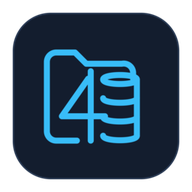

#  File4Base (f4b)

[](https://github.com/file4base/file4base-app/releases)
[](https://hub.docker.com/r/cloudresources/file4base-api)
[](https://hub.docker.com/r/cloudresources/file4base-web)
[](https://github.com/file4base/file4base-app/blob/main/server/go.mod)
[](https://github.com/file4base/file4base-app/tree/main/client)
[](https://goreportcard.com/report/github.com/file4base/file4base-app)
[](https://github.com/file4base/file4base-app/blob/main/LICENSE)
[](https://github.com/file4base/file4base-app/actions/workflows/code_quality.yml)
[](https://github.com/file4base/file4base-app/actions/workflows/desktop_release.yml)
[](https://file4base.github.io/file4base-app/)
[](https://github.com/file4base/file4base-app/issues)
[](https://github.com/file4base/file4base-app/pulls)
[](https://github.com/file4base/file4base-app/stargazers)
[](https://github.com/file4base/file4base-app/network)
[](https://hub.docker.com/r/cloudresources/file4base-api)
[](https://hub.docker.com/r/cloudresources/file4base-web)
[](https://hub.docker.com/r/cloudresources/file4base-api)
[](https://pkg.go.dev/github.com/file4base/file4base-app)
[](https://github.com/file4base/file4base-app/graphs/contributors)
[](https://github.com/file4base/file4base-app)
[](https://github.com/file4base/file4base-app/commits/main)
[](https://deepwiki.com/file4base/file4base-app)

**File4Base** is a powerful open-source low-code relational database and visual layout platform that combines the **rapid visual design of classic desktop database studios** (drag-and-drop layouts, portals, scripts, Kiosk mode, and instant form/list/report views) with the **reliability of a modern cloud-native stack** (decoupled Go REST API, PostgreSQL 16 / MariaDB 11 persistence, multi-user RBAC + TOTP MFA, and Dockerized Web & Native Desktop clients).

File4Base is an independent project. References to Claris products do not imply
affiliation, sponsorship or endorsement. Claris, FileMaker and FileMaker
WebDirect are trademarks of Claris International Inc. See the
[license and reference-material guidance](docs/LEGAL.md) and
[contribution guidelines](CONTRIBUTING.md).

## Architecture Highlights
- **Backend (Go 1.26+)**: REST API with per-database sessions and role-based authorization, Clean Architecture, `pgx/v5`, PostgreSQL 16. Real-time WebSocket sync is planned (Roadmap Phase 6).
- **Frontend (Flutter Desktop & Web Client)**: Native desktop application targeting macOS (Apple Silicon M-series & Intel), Windows, and Linux, plus the containerized **File4Base Web Client** served via Nginx.
- **Server Tools & Container Update Watcher**: Built-in administration console for container monitoring, version update detection & pre-backup stack upgrades, point-in-time snapshots, ACME SSL/TLS, live API telemetry, and cron schedules.
- **Environment & Preflight Engine**: Automated startup check verifying Docker presence, daemon state, and host architecture, with direct download and auto-launch prompts.
- **Data Persistence**: Relational storage in PostgreSQL/MariaDB running locally in Docker with dynamic schema metadata tables.


## Repository Documentation
- [Architecture Specification](docs/specs/ARCHITECTURE.md)
- [API Best Practices & Telemetry Specification](docs/specs/API_BEST_PRACTICES.md)
- [REST API Reference](docs/api/API_REFERENCE.md)
- [Implementation Roadmap](docs/specs/ROADMAP.md)
- [Database Abstraction Layer (DBAL) Spec](docs/specs/DBAL_SPECIFICATION.md)
- [Functional Specification (Feature Mapping)](docs/specs/FUNCTIONAL_SPECIFICATION.md)
- [Dynamic Layout JSON Schema](docs/specs/layout_schema.json)
- [Menu Bar & Functional Command Reference](docs/specs/file4base_menu_reference_guide.md)
- [Assisted FileMaker Migration Specification](docs/specs/filemaker_migration.md)
- [FileMaker to File4Base Migration Guide & Case Study (`Recipes`)](docs/tutorials/filemaker_migration_guide.md)


## Security Model
- **Sessions**: `POST /api/v1/auth/login` returns a bearer token bound to one user and one database. Every schema, data, security and solution endpoint requires it; only the health probes, Swagger UI, sign-in and the database selector are public.
- **Per-session database**: the server keeps no global "active database". Two clients signed in to different databases never affect each other.
- **Roles enforced by the server**: `owner`, `admin` and `user`, plus per-layout permissions (`read_write`, `read_only`, `none`) that also govern record access through the data API.
- **No default accounts**: a database gets its first owner with the credentials chosen when it is created.
- **Configuration** (environment variables of the API server): `DATABASE_URL`, `SESSION_TTL` (default `12h`), `CORS_ALLOWED_ORIGINS` (default `*`), `ALLOW_PUBLIC_DATABASE_CREATION` (default `true`; set to `false` on shared servers), `FILE4BASE_ADMIN_DATABASE` (the owners of that database administer the server through the server-wide Server Tools; empty disables them).

Details: [REST API Reference - Authentication & Authorization](docs/api/API_REFERENCE.md#authentication--authorization).

## Execution Modalities

### 1. Server Deployment (Docker Compose)
When launched via Docker Compose, File4Base acts as a full multi-user application server:
- **PostgreSQL 16**: Port `5432`, published on `127.0.0.1` only by default (MariaDB: see below)
- **Backend Core API (Go)**: Port `8080` (`/healthz`, `/api/v1/schemas`, `/api/v1/data`)
- **File4Base Web Client (Nginx)**: Port `3000` (browser-accessible client)

```bash
# Optional: set your own database password and server options
cp .env.example .env

# Start complete File4Base server stack (builds the API and the web client images)
docker compose up -d

# Check server health
curl http://localhost:8080/healthz

# Access web application
open http://localhost:3000
```

On a new Docker volume, PostgreSQL starts with its administrative `postgres`
database and no File4Base solution database. Create a solution database from
the client's database login screen or import a `.f4p` solution. Docker's
`POSTGRES_DB` setting only applies when PostgreSQL initializes an empty data
volume: existing volumes keep their databases and data, which remain available
in the database selector. Do not remove a volume to change this behavior unless
you intend to delete its persisted data.

#### Images and versions
The images are published on Docker Hub for `linux/amd64`, `linux/arm64` and
`linux/arm/v7`, so they run on macOS and Windows (Docker Desktop, Intel or Apple
Silicon / ARM), Linux on Intel/AMD or ARM, and Raspberry Pi with a 64-bit or
32-bit OS:
[`cloudresources/file4base-api`](https://hub.docker.com/r/cloudresources/file4base-api) and
[`cloudresources/file4base-web`](https://hub.docker.com/r/cloudresources/file4base-web),
tagged with the version in the root `VERSION` file (and `latest`).

```bash
docker compose pull && docker compose up -d   # run the published images
docker compose up -d --build                  # or build them locally
./scripts/publish_images.sh                   # maintainers: build and push a release
```

Set `FILE4BASE_VERSION` (tag) or `FILE4BASE_REGISTRY` (Docker Hub namespace)
in `.env` to run another release or registry.

#### Data persistence and backups
PostgreSQL stores all its databases in the named Docker volume
`file4base-postgres-data`. It survives `docker compose down` and image rebuilds;
only `docker compose down -v` or `docker volume rm` delete it.

```bash
# Back up every database (and roles) to backups/file4base-postgres-v<version>-<date>.sql.gz
./scripts/backup_postgres.sh backup

# List backups / restore one (asks for confirmation, stops the API meanwhile)
./scripts/backup_postgres.sh list
./scripts/backup_postgres.sh restore backups/<file>.sql.gz
```

#### MariaDB instead of PostgreSQL
`docker-compose.mariadb.yml` is the same stack on MariaDB 11: the API runs with
`DB_ENGINE=mariadb` and a MySQL-format DSN, and `deploy/mariadb/init.sql` grants
the API account the privileges it needs to create one database per solution.

```bash
docker compose -f docker-compose.mariadb.yml up -d
```

It is a separate stack, not an overlay: run one engine at a time (both bind the
same host ports), and note that solutions do not move between engines by
copying volumes — export a solution and its data and import them into the other
stack. The Go test suite runs against both engines in CI
(`F4B_TEST_ENGINE=mariadb`).

A restore checks the archive before stopping anything and stops at the first
SQL error. Its exit status says what happened: `0` restored (the API is
started again if it was running), `1` nothing was changed, `2` the restore
failed part-way (the databases may be partially restored; the API is left
stopped until a backup is restored again), `3` restored but the API could not
be started. `RESTORE_CONFIRM=restore` skips the confirmation prompt;
`scripts/tests/backup_postgres_test.sh` tests these outcomes.

### 2. Standalone Desktop Client (macOS / Windows / Linux)
The native desktop client runs locally on developer workstations (including Apple Silicon M-series Macs, Windows, and Linux):
- Connects through configurable port (default: `http://localhost:8080`), with interactive Host & Port Settings dialog (accessible by clicking the server status pill in the AppBar).
- Performs generic preflight checks (connectivity, Docker daemon, database engine status).
- Official adaptive light/dark branding icons integrated into macOS `.appiconset`, Windows `app_icon.ico`, and Linux headers.

```bash
# Run locally in development
cd client
flutter run -d macos    # or windows, linux

# Build native release bundles with packaging script
./scripts/build_desktop.sh macos     # outputs dist/File4Base-macOS-universal.zip
./scripts/build_desktop.sh windows   # outputs dist/File4Base-Windows-x64.zip
./scripts/build_desktop.sh linux     # outputs dist/File4Base-Linux-x64.tar.gz
```

### 3. Automated CI/CD Workflows
A GitHub Actions workflow (`.github/workflows/desktop_release.yml`) runs the Go server checks (`go vet` and the test suite against a PostgreSQL service) and the Flutter tests, and automatically compiles and packages native release builds for macOS, Windows, and Linux on every release tag or workflow dispatch.

## Documentation

- **[Complete File4Base v0.19.2 Manual (`docs/manual-file4base-0.19.2.md`)](docs/manual-file4base-0.19.2.md)** — Full User, Visual Designer, Schema & Scripting Engineer, and Server Administrator manual with 20 UI screenshots (`docs/images/manual-0.19.2/`).
- **[REST API & Realtime Reference (`docs/api/API_REFERENCE.md`)](docs/api/API_REFERENCE.md)** — Complete `/api/v1/*` and WebSocket protocol documentation.
- **[Menu Reference Guide (`docs/specs/file4base_menu_reference_guide.md`)](docs/specs/file4base_menu_reference_guide.md)** — Detailed menu bar and shortcut reference.
- **[Server Tools & MFA Specification (`docs/specs/server_tools_and_mfa.md`)](docs/specs/server_tools_and_mfa.md)** — Architecture and operational guide for the 9 Server Tools modules and TOTP 2FA.
