# File4Base v0.19.2 — Complete User, Designer & Administrator Manual

**Document Version:** `0.19.2`  
**Release Date:** October 2026  
**Target Components:** File4Base Go API Server (`v0.19.2`), File4Base Desktop Client (macOS / Linux / Windows `v0.19.2`), and **File4Base Web Client** (`v0.19.2`)  
**Supported Relational Engines:** PostgreSQL 16 (Default) & MariaDB 11 (Optional Profile)

---

## Table of Contents

1. [Introduction & System Architecture](#1-introduction--system-architecture)
   - [1.1 What Is File4Base?](#11-what-is-file4base)
   - [1.2 What's New in Version 0.19.2](#12-whats-new-in-version-0192)
   - [1.3 Multi-Tier Architecture & Data Flow](#13-multi-tier-architecture--data-flow)
   - [1.4 Four Operational Modes](#14-four-operational-modes)
2. [Installation, Deployment & Preflight](#2-installation-deployment--preflight)
   - [2.1 Docker Compose Deployment (PostgreSQL 16 & MariaDB 11)](#21-docker-compose-deployment-postgresql-16--mariadb-11)
   - [2.2 Server Environment Variables Reference](#22-server-environment-variables-reference)
   - [2.3 Automated Preflight & Health Verification](#23-automated-preflight--health-verification)
   - [2.4 Native Desktop Client & File4Base Web Client](#24-native-desktop-client--file4base-web-client)
   - [2.5 In-App New-Version Detection & Guided Stack Updates](#25-in-app-new-version-detection--guided-stack-updates)
3. [Connecting, Authentication & Solution Bundles](#3-connecting-authentication--solution-bundles)
   - [3.1 Connecting to a Server & Logging In](#31-connecting-to-a-server--logging-in)
   - [3.2 Multi-Factor Authentication (TOTP 2FA) at Login](#32-multi-factor-authentication-totp-2fa-at-login)
   - [3.3 Working with Solution Files (`.f4p` and `.f4data`)](#33-working-with-solution-files-f4p-and-f4data)
   - [3.4 File Options & Startup Triggers](#34-file-options--startup-triggers)
4. [Complete Menu Bar & Keyboard Shortcuts Reference](#4-complete-menu-bar--keyboard-shortcuts-reference)
   - [4.1 Top Menu Bar Architecture](#41-top-menu-bar-architecture)
   - [4.2 Menu-by-Menu Command Reference](#42-menu-by-menu-command-reference)
5. [Working with Data: Browse Mode & Views](#5-working-with-data-browse-mode--views)
   - [5.1 Form View & Status Sidebar Navigation](#51-form-view--status-sidebar-navigation)
   - [5.2 List View & Table View (Single-Click Inline Grid Editing)](#52-list-view--table-view-single-click-inline-grid-editing)
   - [5.3 Creating, Duplicating, Committing & Reverting Records](#53-creating-duplicating-committing--reverting-records)
   - [5.4 Multi-Field Sorting (`Sort Records`)](#54-multi-field-sorting-sort-records)
   - [5.5 Portals (Related Records), Container Fields & Web Viewers](#55-portals-related-records-container-fields--web-viewers)
   - [5.6 Real-Time Multi-User Synchronization (WebSockets)](#56-real-time-multi-user-synchronization-websockets)
6. [Searching & Filtering: Find Mode & Saved Finds](#6-searching--filtering-find-mode--saved-finds)
   - [6.1 Building Multi-Request Queries (`Include` & `Omit`)](#61-building-multi-request-queries-include--omit)
   - [6.2 Search Operators & Wildcards Reference](#62-search-operators--wildcards-reference)
   - [6.3 Constrain Found Set, Extend Found Set & Saved Finds](#63-constrain-found-set-extend-found-set--saved-finds)
7. [Schema Engineering: Manage Database](#7-schema-engineering-manage-database)
   - [7.1 Multi-Database Catalog (`Databases` Tab)](#71-multi-database-catalog-databases-tab)
   - [7.2 Table Management & Bulk Operations (`Tables` Tab)](#72-table-management--bulk-operations-tables-tab)
   - [7.3 Agnostic Field Types, Calculations & Summaries (`Fields` Tab)](#73-agnostic-field-types-calculations--summaries-fields-tab)
   - [7.4 Field Options: Auto-Enter & Validation Rules](#74-field-options-auto-enter--validation-rules)
   - [7.5 Interactive Relationships Graph & Table Occurrences](#75-interactive-relationships-graph--table-occurrences)
8. [Visual Layout Studio: Layout Mode](#8-visual-layout-studio-layout-mode)
   - [8.1 WYSIWYG Canvas, 96px Horizontal Part Rail & Rulers](#81-wysiwyg-canvas-96px-horizontal-part-rail--rulers)
   - [8.2 New Layout / Report Assistant](#82-new-layout--report-assistant)
   - [8.3 Layout Parts (`Header`, `Body`, `Sub-Summary`, `Grand Summary`, `Footer`)](#83-layout-parts-header-body-sub-summary-grand-summary-footer)
   - [8.4 Tool Palette, Objects, Merge Fields & Value Lists](#84-tool-palette-objects-merge-fields--value-lists)
   - [8.5 Property Inspector (Position, Style, Data & Appearance)](#85-property-inspector-position-style-data--appearance)
   - [8.6 Integrated Analytics & Chart Views](#86-integrated-analytics--chart-views)
   - [8.7 Layout Themes & Cross-Solution Copy/Paste](#87-layout-themes--cross-solution-copypaste)
9. [Printing, Page Setup & Preview Mode](#9-printing-page-setup--preview-mode)
   - [9.1 Page Setup & Printable Margin Guides](#91-page-setup--printable-margin-guides)
   - [9.2 Preview Mode, Grouped Reports & Multi-Column Labels](#92-preview-mode-grouped-reports--multi-column-labels)
10. [Automation & Calculations: Script Workspace, Debugger & Data Viewer](#10-automation--calculations-script-workspace-debugger--data-viewer)
    - [10.1 3-Panel Script Workspace IDE](#101-3-panel-script-workspace-ide)
    - [10.2 Built-In Script Steps Catalog](#102-built-in-script-steps-catalog)
    - [10.3 Calculation Formula Builder & 20-Function Engine](#103-calculation-formula-builder--20-function-engine)
    - [10.4 Interactive Step-by-Step Script Debugger & Data Viewer](#104-interactive-step-by-step-script-debugger--data-viewer)
11. [Security, RBAC, TOTP 2FA & Super-Owner Governance](#11-security-rbac-totp-2fa--super-owner-governance)
    - [11.1 Account Roles (`Owner`, `Admin`, `User`) & Privilege Sets](#111-account-roles-owner-admin-user--privilege-sets)
    - [11.2 Super-Owner Privilege Switch & Server-Wide Delegation](#112-super-owner-privilege-switch--server-wide-delegation)
    - [11.3 Google Authenticator TOTP 2FA Enrollment & Enforcement](#113-google-authenticator-totp-2fa-enrollment--enforcement)
    - [11.4 Per-Layout & Per-Table Granular Permissions](#114-per-layout--per-table-granular-permissions)
    - [11.5 Extended Privileges & Brute-Force Rate Limiting](#115-extended-privileges--brute-force-rate-limiting)
12. [Developer Utilities, Kiosk Mode, Encryption & Migration](#12-developer-utilities-kiosk-mode-encryption--migration)
    - [12.1 Cloning, Renaming & Permanent Design Lock](#121-cloning-renaming--permanent-design-lock)
    - [12.2 Kiosk Mode & Pre-Flight Readiness Check](#122-kiosk-mode--pre-flight-readiness-check)
    - [12.3 AES-256-GCM Transport & Bundle Encryption](#123-aes-256-gcm-transport--bundle-encryption)
    - [12.4 Import/Export Records & External SQL Data Sources](#124-importexport-records--external-sql-data-sources)
    - [12.5 Database Design Report (DDR) & Assisted FileMaker Migration](#125-database-design-report-ddr--assisted-filemaker-migration)
13. [Server Tools Administration Console](#13-server-tools-administration-console)
    - [13.1 Integrated `Manage` Menu & Access Control](#131-integrated-manage-menu--access-control)
    - [13.2 Module 1: Docker Containers, Updates & Live Logs](#132-module-1-docker-containers-updates--live-logs)
    - [13.3 Module 2: Backups & Snapshots (`.tar.gz` / `.f4b.json`)](#133-module-2-backups--snapshots-targz--f4bjson)
    - [13.4 Module 3: Domain & SSL/TLS (ACME Let's Encrypt / ZeroSSL)](#134-module-3-domain--ssltls-acme-lets-encrypt--zerossl)
    - [13.5 Module 4: Live API Telemetry & 60-Minute Traffic Charts](#135-module-4-live-api-telemetry--60-minute-traffic-charts)
    - [13.6 Modules 5–9: Sessions, Cron Schedules, Audit Logs, Maintenance & Alerts](#136-modules-59-sessions-cron-schedules-audit-logs-maintenance--alerts)
14. [REST API & Realtime WebSocket Reference](#14-rest-api--realtime-websocket-reference)
    - [14.1 Authentication Headers & Encrypted Payload Envelope](#141-authentication-headers--encrypted-payload-envelope)
    - [14.2 Core REST API Endpoints Summary](#142-core-rest-api-endpoints-summary)
    - [14.3 WebSocket Realtime Protocol (`/api/v1/realtime`)](#143-websocket-realtime-protocol-apiv1realtime)

---

## 1. Introduction & System Architecture

### 1.1 What Is File4Base?

**File4Base** is a self-hosted, multi-engine visual database design and low-code application platform. Inspired by the rapid application development ergonomics of classic desktop database builders while engineered from the ground up on modern open standards, File4Base pairs a high-concurrency **Go 1.26+ REST & WebSocket API Server** with a cross-platform **Flutter Desktop Client** (macOS, Linux, Windows) and the browser-based **File4Base Web Client**.

Unlike legacy file-locked desktop databases, every table and column you create in File4Base is materialized directly as native **PostgreSQL 16** (or **MariaDB 11**) DDL inside an ACID-compliant relational engine, while layout definitions, scripts, value lists, relationships, and security policies are stored in a deterministic metadata catalog.

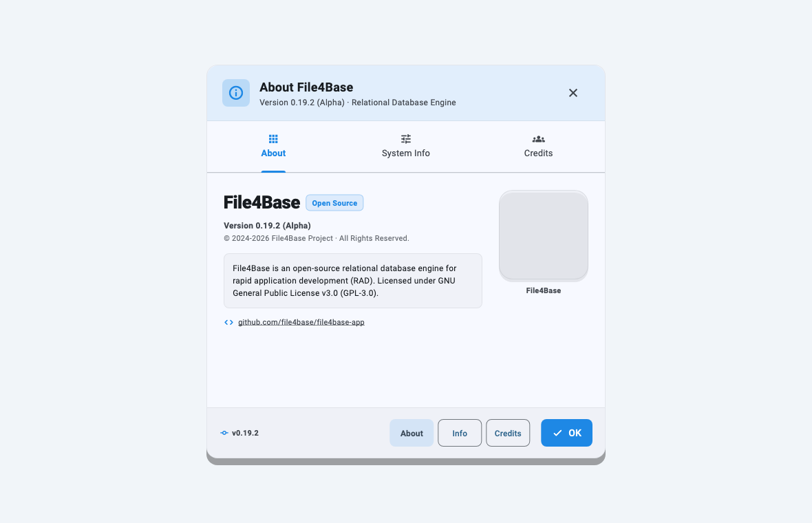

### 1.2 What's New in Version 0.19.2

Version `0.19.2` introduces major operational, administrative, and user-experience enhancements:

- **Live In-App Web Client New-Version Banner (`version.json` Polling):** The **File4Base Web Client** now polls `/version.json` with a cache-busting query every 3 minutes (and 8 seconds after startup) without waiting for a service-worker reload. Whenever a newer container image is deployed or published, an amber banner appears in the top bar with a one-click **Update now** action.
- **Guided Stack Update Dialog (`UpdateAvailableDialog`):** Clicking the update badge opens a guided modal showing current vs. available versions, release notes, and a **Deploy update** button that automatically takes a pre-update database snapshot and provides the exact host command (`docker compose pull && docker compose up -d`).
- **Manage Menu Integrated into Server Tools:** Both the top `Server Tools` menu and the left navigation rail of the **Server Tools & Administration** console now include a **Manage** section providing direct, one-click access to `Database...`, `Security...`, `Value Lists...`, `External Data Sources...`, `Layouts...`, `Scripts...`, and `Custom Menus...`.
- **Super-Owner Privilege Switch & Delegation:** Super-owners can promote or demote any account in **Manage Security** via the **Super-owner (full server control)** switch or the gold shield icon in the accounts table. Non-owner accounts are automatically promoted to `[Full Access] Owner` when granted Super-owner privileges.
- **Real-Time Multi-Window WebSocket Synchronization:** Schema changes, layout saves, and record mutations broadcast immediately over `/api/v1/realtime` to all connected desktop and browser sessions viewing the same database.
- **Horizontal 96px Part Rail in Layout Mode:** Part labels (`Header`, `Body`, `Sub-Summary`, `Footer`) are displayed horizontally in a dedicated `96px` left rail alongside the canvas so labels never overlap layout objects.

### 1.3 Multi-Tier Architecture & Data Flow

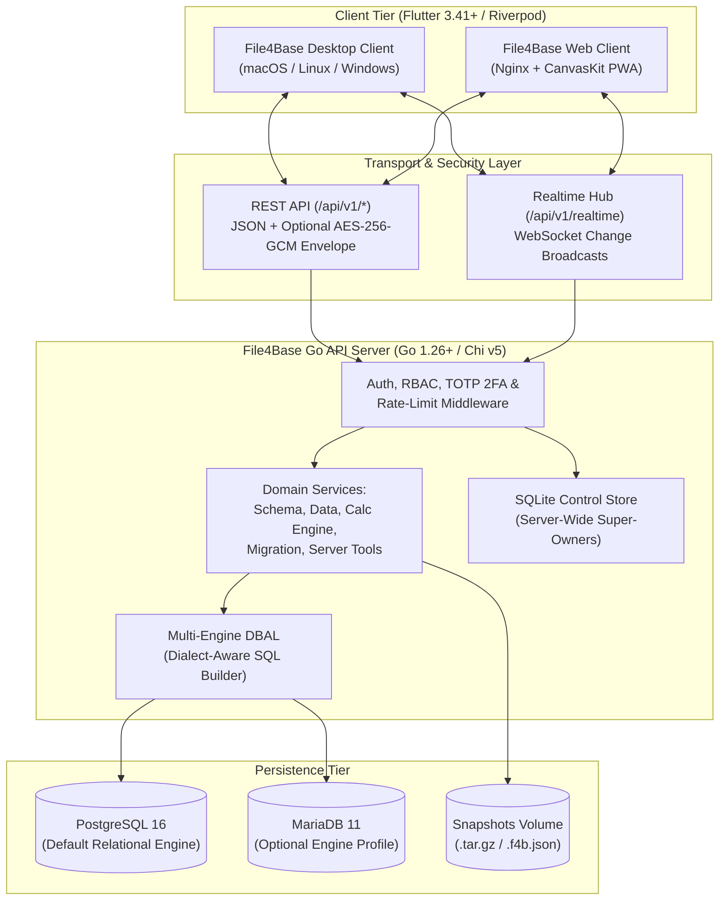

### 1.4 Four Operational Modes

File4Base organizes all user and developer activity into four distinct operational modes, switchable at any time from the **View** menu or via keyboard shortcuts:

| Operational Mode | Shortcut | Primary Purpose |
| :--- | :--- | :--- |
| **Browse Mode** | `Cmd+B` / `Ctrl+B` | Enter, edit, delete, sort, and navigate live records in **Form View**, **List View**, or **Table View**, interact with portals, and trigger scripts. |
| **Find Mode** | `Cmd+F` / `Ctrl+F` | Build single- or multi-request search queries using wildcard operators (`*`, `@`, `?`, `...`, `//`, `=`, `!`) and `Include`/`Omit` rules. |
| **Layout Mode** | `Cmd+L` / `Ctrl+L` | Visually design forms, list views, grouped reports, charts, portals, buttons, tab controls, and print margins on a WYSIWYG canvas. |
| **Preview Mode** | `Cmd+U` / `Ctrl+U` | Inspect paginated print output, sub-summary break groups, grand totals, multi-column label sheets, and page margins prior to printing or PDF export. |

---

## 2. Installation, Deployment & Preflight

### 2.1 Docker Compose Deployment (PostgreSQL 16 & MariaDB 11)

All official File4Base containers, images, volumes, and networks strictly follow the `file4base-` naming convention (`file4base-api`, `file4base-web`, `file4base-postgres`, `file4base-mariadb`, `file4base-net`).

#### Option A: Default Stack (PostgreSQL 16)

```bash
# 1. Clone the repository and copy the environment template
cp .env.example .env

# 2. Launch PostgreSQL 16, File4Base API Server, and File4Base Web Client
docker compose up -d --build

# 3. Verify container health
docker compose ps
```

- **File4Base Web Client:** `http://localhost:3000`
- **File4Base REST API & Swagger UI:** `http://localhost:8080/swagger/`
- **PostgreSQL 16 (Localhost-bound):** `127.0.0.1:5432`

#### Option B: MariaDB 11 Stack Profile

```bash
DB_ENGINE=mysql \
DB_PORT=3306 \
DB_DSN="file4base:file4base_secret@tcp(file4base-mariadb:3306)/file4base?parseTime=true&multiStatements=true" \
docker compose --profile mariadb up -d --build
```

### 2.2 Server Environment Variables Reference

Configure these variables in `.env` or your container orchestrator:

| Variable | Default | Description |
| :--- | :--- | :--- |
| `DB_ENGINE` | `postgres` | Database engine dialect (`postgres` or `mysql`). |
| `DB_DSN` | `postgres://...` | Primary database connection string. |
| `PORT` | `8080` | HTTP port exposed by `file4base-api`. |
| `FILE4BASE_ADMIN_DATABASE` | *(empty)* | Restricts server-wide **Server Tools** administration to `owner` accounts of this specific database when no explicit Super-owner is seeded. |
| `FILE4BASE_SUPER_OWNER` | *(empty)* | Comma-separated list of `database:username` pairs (or bare `username`s) seeded as server-wide Super-owners in the SQLite control store at startup. |
| `FILE4BASE_CONTROL_DB` | `/var/lib/file4base/control/server_control.sqlite` | Path to the SQLite control store persisting server-wide Super-owner grants. |
| `FILE4BASE_TRUSTED_PROXIES` | *(empty)* | Comma-separated CIDRs or IPs of reverse proxies trusted to supply `X-Forwarded-For` / `X-Real-IP` headers for login rate limiting. |
| `FILE4BASE_CORS_ALLOWED_ORIGINS` | `*` | Comma-separated list of origins permitted for cross-origin browser requests. |
| `FILE4BASE_BACKUP_DIR` | `/tmp/file4base-backups` | Directory inside `file4base-api` where `.f4b.json` and `.tar.gz` database snapshots are stored. |

### 2.3 Automated Preflight & Health Verification

Before opening the studio or running end-to-end tests, run the preflight verification script to confirm Docker daemon readiness, port availability, `/healthz` probes, and database connectivity:

```bash
./scripts/preflight_check.sh
```

You can also probe the API health endpoint directly:

```bash
curl -s http://localhost:8080/healthz | jq .
```

### 2.4 Native Desktop Client & File4Base Web Client

- **File4Base Web Client:** Served by `file4base-web` on port `3000`, the browser client runs the full Flutter studio workspace and proxies `/api/` and `/healthz` requests directly to `file4base-api:8080`.
- **Native Desktop Client (macOS / Linux / Windows):**
  ```bash
  # Build or launch via the helper script
  ./scripts/run_client.sh
  ```
  Furthermore, the **File4Base Web Client** login dialog offers direct one-click downloads of pre-packaged native desktop builds (`/downloads/file4base-macos.zip`, `/downloads/file4base-linux.tar.gz`, `/downloads/file4base-windows.zip`) when bundled inside the web container.

### 2.5 In-App New-Version Detection & Guided Stack Updates

File4Base `v0.19.2` features dual-layer update detection:

1. **Web Client `version.json` Watcher:** When running in a browser, the client fetches `/version.json?_ts=<epoch>` every 3 minutes. If the served `version` differs from the running client bundle, or if the backend container watcher reports a newer image on Docker Hub / GitHub Releases, an amber **`Update vX.Y.Z`** pill appears in the top menu bar.
2. **Guided Deployment Modal:** Clicking the update pill opens the **A new version is available** dialog, displaying release notes and a **Deploy update** button.

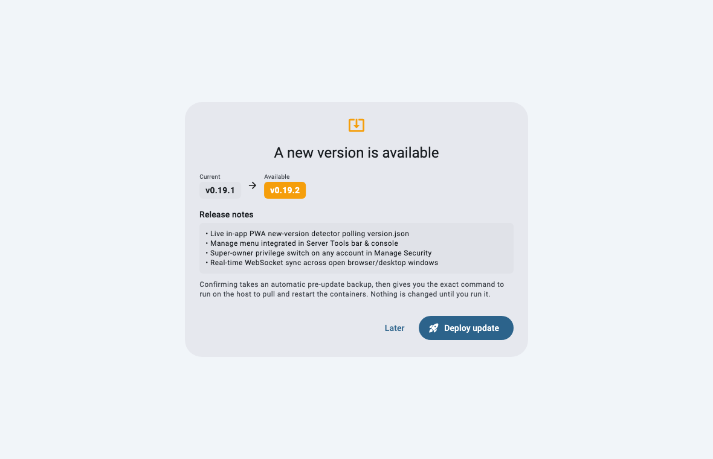

> [!TIP]
> Clicking **Deploy update** automatically snapshots the active database before copying `docker compose pull && docker compose up -d` (or downloading a ready-to-run `update-file4base.sh` / `.bat` script) so you never risk data loss during a stack upgrade.

---

## 3. Connecting, Authentication & Solution Bundles

### 3.1 Connecting to a Server & Logging In

When File4Base starts, or when you choose **File > Open Remote / Change Database...** (`Cmd+Shift+O` / `Ctrl+Shift+O`), the **Connect to File4Base Server** dialog appears:

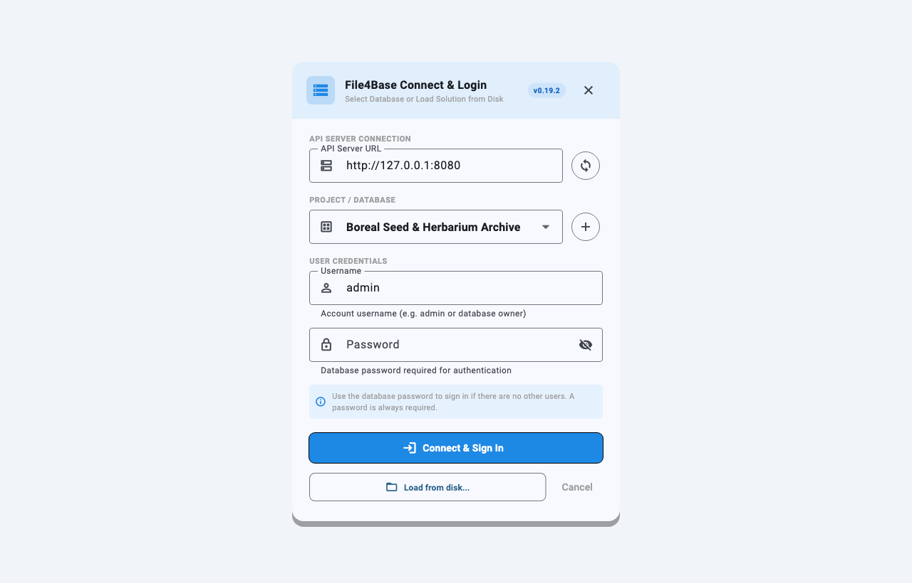

1. **API Server URL:** Enter your File4Base server endpoint (for example, `http://127.0.0.1:8080` on desktop, or the automatic relative origin on **File4Base Web Client**) and click **Probe** (refresh icon) to verify connectivity and load the database catalog.
2. **Database Selection:** Choose an existing relational database from the dropdown or click **`+ New Database...`** to provision a fresh PostgreSQL/MariaDB database on the spot.
3. **Credentials:** Enter your **Username** and **Password**.
   - If a database has just been created and has zero registered accounts, File4Base displays an initial setup banner allowing you to bootstrap the first `[Full Access] Owner` account directly from the login dialog.

### 3.2 Multi-Factor Authentication (TOTP 2FA) at Login

If the account has **Google Authenticator (RFC 6238 TOTP)** enabled:
1. Submitting a valid username and password transitions the login dialog into the **Two-Factor Verification** step.
2. Enter the current **6-digit TOTP code** from Google Authenticator, Authy, 1Password, or Apple Passwords (codes are validated with a $\pm 30\text{s}$ clock-drift tolerance window).
3. Upon verification, the server issues a 24-hour session Bearer token and opens the solution's default startup layout.

### 3.3 Working with Solution Files (`.f4p` and `.f4data`)

File4Base supports portable local files alongside live server databases:

| File Extension | Menu Command | Contents & Use Case |
| :--- | :--- | :--- |
| **`.f4p`** | **File > Save Project Local (`.f4p`)** / **Open File (`.f4p`)** | Complete portable solution bundle containing table schemas, fields, relationships, layouts, scripts, value lists, custom menus, solution metadata, and optional embedded record snapshots. Can be encrypted with **AES-256-GCM**. |
| **`.f4data`** | **File > Save Data Snapshot (`.f4data`)** / **Load Data Snapshot** | Lightweight JSON data archive containing table rows for rapid dataset switching, testing, or offline archival. |
| **`.f4b.json` / `.tar.gz`** | **Server Tools > Backups & Snapshots** | Full server-managed point-in-time database backup archive with gzip compression, metadata manifest, and one-click server restore. |

### 3.4 File Options & Startup Triggers

Open **File > File Options...** to configure how a solution behaves when a user logs in:
- **Minimum Allowed Version:** Enforce a minimum File4Base client version (e.g., `0.19.2`).
- **Default Login Account:** Optionally pre-fill a guest or operator account.
- **Switch to Layout on Open:** Automatically navigate to a designated home or dashboard layout on startup.
- **Script Triggers:** Attach scripts to lifecycle events:
  - `OnFirstWindowOpen` — Runs once when the solution is opened.
  - `OnLastWindowClose` — Runs before the solution closes.
  - `OnWindowOpen` / `OnWindowClose` — Runs on individual window creation or teardown.

---

## 4. Complete Menu Bar & Keyboard Shortcuts Reference

### 4.1 Top Menu Bar Architecture

The `File4BaseMenuBar` sits at the top of the studio window (unless hidden for non-admin accounts in **Kiosk Mode**) and provides 10 contextual menus plus quick-status badges on the right (active database indicator, update notification pill, encryption lock badge, and Kiosk preview toggle).

### 4.2 Menu-by-Menu Command Reference

#### `File` Menu
| Command | Shortcut | Description |
| :--- | :--- | :--- |
| **New Solution...** | `Cmd+N` / `Ctrl+N` | Launches the guided New Solution Wizard to create a new database, initial table, and default layout. |
| **Open File (`.f4p`)...** | `Cmd+O` / `Ctrl+O` | Opens a local `.f4p` solution bundle from disk and restores its schema and layouts to the active server. |
| **Open Remote / Change Database...** | `Cmd+Shift+O` | Opens the Connect & Login dialog to switch databases, servers, or user accounts. |
| **Open Recent** | — | Submenu listing the 10 most recently accessed databases and `.f4p` files. |
| **File Options...** | — | Configures startup layout, minimum version, encryption status, and window script triggers. |
| **Manage > Database...** | `Cmd+Shift+D` | Opens **Manage Database** (`Databases`, `Tables`, `Fields`, and `Relationships Graph`). |
| **Manage > Security...** | — | Opens **Manage Security** (Accounts, Roles, TOTP 2FA, Super-owner switch, Layout & Table privileges). |
| **Manage > Value Lists...** | — | Opens **Manage Value Lists** for custom static or field-backed dropdown lists. |
| **Manage > Layouts...** | — | Opens **Manage Layouts** to reorder, duplicate, rename, or delete layouts. |
| **Manage > Scripts...** | `Cmd+Shift+S` | Opens the 3-panel **Script Workspace IDE**. |
| **Manage > External Data Sources...** | — | Configures live external PostgreSQL, MariaDB/MySQL, or SQL Server connections. |
| **Manage > Custom Menus...** | — | Customizes menu visibility and custom menu items per solution. |
| **Sharing > Network Access & Users...** | — | Configures multi-user network sharing and inspects active client sessions. |
| **Save Project Local (`.f4p`)** | `Cmd+S` / `Ctrl+S` | Exports the complete solution as a portable `.f4p` file. |
| **Save a Copy As...** | — | Saves a full copy, a clone without records, or a self-contained backup. |
| **Import Records > From File (CSV, TSV, Excel, XML)...** | — | Opens the **Import Records** field-mapping wizard. |
| **Import Records > From SQL Data Source...** | — | Imports rows from a configured External SQL Data Source. |
| **Import Records > FileMaker Solution (`.fmp12` + DDR)...** | — | Launches the **Assisted FileMaker Migration Wizard**. |
| **Export Records...** | — | Exports the current found set to CSV, TSV, JSON, XML, HTML Table, or Excel (`.xlsx`). |
| **Page Setup...** | — | Configures paper size (`A4`, `Letter`, `Legal`, `A3`, `A5`, `Tabloid`), orientation, and margins. |
| **Print...** | `Cmd+P` / `Ctrl+P` | Switches to **Preview Mode** and launches the native print/PDF pipeline. |

#### `Edit` Menu
| Command | Shortcut | Description |
| :--- | :--- | :--- |
| **Undo / Redo** | `Cmd+Z` / `Cmd+Shift+Z` | Undoes or redoes canvas edits in **Layout Mode** (up to 50 undo levels) or text edits in **Browse Mode**. |
| **Cut / Copy / Paste** | `Cmd+X` / `Cmd+C` / `Cmd+V` | Cuts, copies, or pastes selected layout objects (with automatic `+16px` cascade offset) or field text. |
| **Duplicate** | `Cmd+D` / `Ctrl+D` | Duplicates the selected layout object in **Layout Mode** or duplicates the active record in **Browse Mode**. |
| **Select All** | `Cmd+A` / `Ctrl+A` | Selects all objects on the active layout canvas. |
| **Find / Replace...** | `Cmd+Alt+F` | Searches and replaces text across records (in **Browse Mode**) or across object labels (in **Layout Mode**). |
| **Spelling > Check Selection / Check Record / Check Layout** | — | Runs the built-in multi-language spell checker (`EN` / `ES`) with custom user dictionary support. |
| **Preferences...** | `Cmd+,` / `Ctrl+,` | Configures UI theme (Light, Dark, System), grid snap settings, and autosave intervals. |

#### `View` Menu
| Command | Shortcut | Description |
| :--- | :--- | :--- |
| **Browse Mode** | `Cmd+B` / `Ctrl+B` | Switches to interactive data entry and record browsing. |
| **Find Mode** | `Cmd+F` / `Ctrl+F` | Switches to the multi-request search query builder. |
| **Layout Mode** | `Cmd+L` / `Ctrl+L` | Opens the visual WYSIWYG layout studio. |
| **Preview Mode** | `Cmd+U` / `Ctrl+U` | Renders paginated print preview sheets. |
| **Go to Layout** | — | Submenu jumping directly to any layout in the solution. |
| **View as Form / View as List / View as Table** | — | Switches the active **Browse Mode** presentation between Form, List, and Table grid views. |
| **Status Toolbar** | `Cmd+Alt+S` | Shows or hides the left Status Sidebar and top action toolbar. |
| **Formatting Bar** | — | Shows or hides the live typography, color, and alignment formatting bar. |
| **Rulers / Text Ruler / Page Margins** | — | Toggles the horizontal/vertical canvas rulers, tab-stop text ruler, and printable page margin guides. |
| **Grid > Show Grid / Snap to Grid** | — | Toggles the `8px` alignment dot grid and magnetic snapping in **Layout Mode**. |
| **Inspector** | `Cmd+I` / `Ctrl+I` | Opens or focuses the right-hand Property Inspector panel in **Layout Mode**. |
| **ObjectsTab / Fields Tab** | — | Focuses the left-hand Field Picker or Objects Hierarchy panel in **Layout Mode**. |
| **Zoom In / Zoom Out / Actual Size (100%)** | `Cmd++` / `Cmd+-` / `Cmd+0` | Scales the workspace canvas between `50%` and `200%`. |

#### `Insert`, `Format`, `Records` / `Requests`, `Scripts`, `Tools` & `Server Tools` Menus
- **`Insert` Menu:** In **Layout Mode**, inserts `Field...`, `Text`, `Button`, `Portal`, `Tab Control`, `Slide Control`, `Popover Button`, `Chart...`, `Web Viewer`, `Picture...`, `Line`, `Rectangle`, `Rounded Rectangle`, `Oval`, `Part...`, `Current Date Symbol ({{CurrentDate}})`, `Current Time Symbol ({{CurrentTime}})`, `Current User Name ({{CurrentUserName}})`, `Page Number Symbol ({{PageNumber}})`, `Record Number Symbol ({{RecordNumber}})`, `Merge Field...`, and `Merge Variable...`. In **Browse Mode**, inserts `Current Date` (`Cmd+-`), `Current Time` (`Cmd+;`), `Current User Name` (`Cmd+Shift+N`), `From Index...` (`Cmd+I`), `From Last Visited Record` (`Cmd+'`), or `Picture / File into Container...`.
- **`Format` Menu:** Applies `Font` family, `Size` (`9pt`–`72pt`), `Style` (`Bold`, `Italic`, `Underline`, `Strikethrough`, `Title Case`, `UPPERCASE`, `lowercase`), `Align Text` (`Left`, `Center`, `Right`, `Justify`), `Line Spacing`, `Orientation` (`Horizontal`, `Sideways`, `Vertical`), `Text Color`, `Fill Color`, and `Conditional Formatting...`.
- **`Records` Menu (or `Requests` in Find Mode):**
  - In **Browse Mode:** `New Record` (`Cmd+N`), `Duplicate Record` (`Cmd+D`), `Delete Record...` (`Cmd+E`), `Delete All Records...`, `Show All Records` (`Cmd+J`), `Show Omitted Only`, `Omit Record` (`Cmd+T`), `Omit Multiple...` (`Cmd+Shift+T`), `Modify Last Find` (`Cmd+R`), `Saved Finds`, `Sort Records...` (`Cmd+S`), `Unsort`, `Replace Field Contents...` (`Cmd+=`), `Relookup Field Contents`, `Revert Record`.
  - In **Find Mode (`Requests`):** `Add New Request` (`Cmd+N`), `Duplicate Request` (`Cmd+D`), `Delete Request` (`Cmd+E`), `Perform Find` (`Enter`), `Cancel Find` (`Esc`), `Include / Omit Request`, `Insert Operator`.
- **`Scripts` Menu:** Opens the **Script Workspace** (`Cmd+Shift+S`) and lists every user script pinned to the menu for one-click execution in **Browse Mode**.
- **`Tools` Menu:** Opens **Script Debugger...**, **Data Viewer...**, **Database Design Report (DDR)...**, **Developer Utilities...**, **Kiosk Mode Readiness Check...**, and **FileMaker Migration Assistant...**.
- **`Server Tools` Menu:** Opens any of the 9 **Server Tools & Administration** modules (`Containers & Services`, `Backups & Snapshots`, `Domain & SSL/TLS`, `API Telemetry & Charts`, `Connected Clients`, `Scheduled Tasks`, `Audit & Security Logs`, `Database Maintenance`, `Alerts, SMTP & Webhooks`) plus the integrated **`Manage`** submenu.

---

## 5. Working with Data: Browse Mode & Views

### 5.1 Form View & Status Sidebar Navigation

**Browse Mode** (`Cmd+B` / `Ctrl+B`) is where end users view, enter, and edit records. By default, layouts open in **Form View**, displaying one record at a time with full fidelity to the canvas coordinates, typography, value lists, portals, and buttons configured in **Layout Mode**.

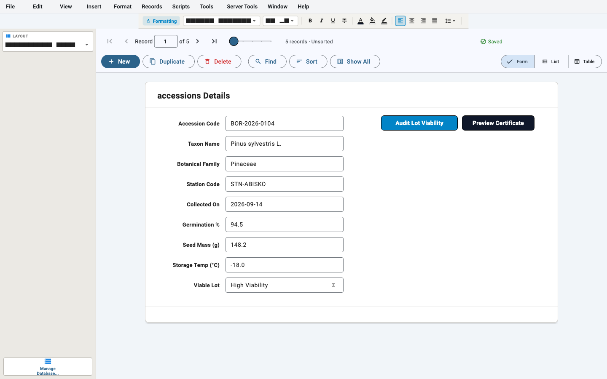

Key elements of the **Browse Mode** workspace:
1. **Left Status Sidebar (`File4BaseStatusSidebar`):**
   - **Layout Selector Dropdown:** Switch between layouts (`Accessions Form`, `Family Summary Report`, etc.) or jump straight to `Manage Layouts...` or `New Layout...`.
   - **Manage Database Button:** Bottom shortcut opening **Manage Database** for accounts with design privileges.
2. **Record Navigation & Status Bar:**
   - **Record Stepper & Scrubber Slider:** Step to the first (`|<`), previous (`<`), next (`>`), or last (`>|`) record, type a specific record index into the `Record [ 1 ] of N` box, or drag the interactive slider.
   - **Found Set & Sort Indicator:** Shows total records vs. filtered found set (e.g., `5 records • Unsorted` or `3 of 5 Found • Sorted`) and the live save status badge (`Saved` in green or `Saving...`).
3. **Quick Action Pill Bar:**
   - **`+ New`**, **`Duplicate`**, **`Delete`**, **`Find`**, **`Sort`**, and **`Show All`** buttons on the left.
   - **`Form` / `List` / `Table`** segmented view switcher on the right.

### 5.2 List View & Table View (Single-Click Inline Grid Editing)

Click **`Table`** (or **`List`**) in the top-right view switcher—or select **View > View as Table**—to inspect and edit records in a high-density relational grid:

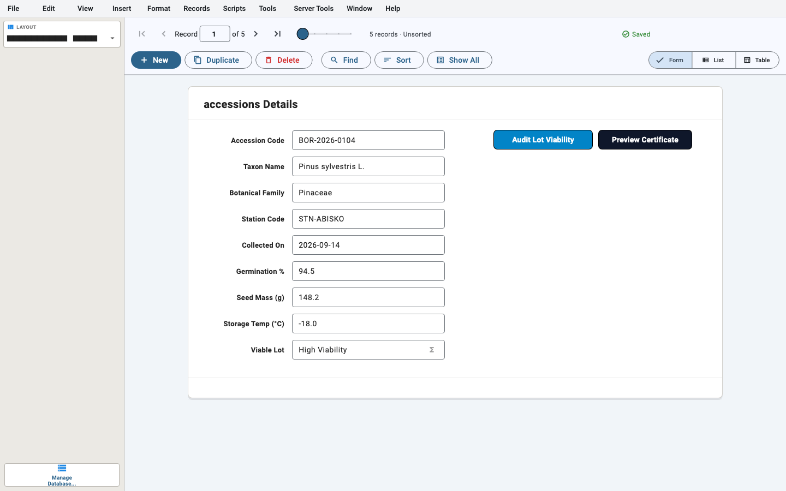

- **Single-Click Inline Cell Editing:** Click any cell in **Table View** (`TEXT`, `NUMBER`, `DATE`, `BOOLEAN`) to edit its value in place. Moving focus or pressing `Enter`/`Tab` commits the change immediately to the server and updates any dependent `CALCULATION` and `SUMMARY` columns.
- **Read-Only Calculated Columns:** Columns of type `CALCULATION` or `SUMMARY` are badged with a sigma (`Σ`) indicator and automatically recomputed by the server's calculation engine.
- **Column Sorting & Selection:** Click column headers to sort ascending/descending, or select a row to make it the active record when switching back to **Form View**.

### 5.3 Creating, Duplicating, Committing & Reverting Records

- **Create Record (`+ New` / `Cmd+N`):** Inserts a new row into the underlying PostgreSQL/MariaDB table, populates any configured **Auto-Enter** values (UUIDs, serial numbers, creation timestamps, default constants, or calculations), and focuses the first editable field.
- **Duplicate Record (`Duplicate` / `Cmd+D`):** Clones all non-primary-key field values of the current record into a brand-new record.
- **Auto-Save & Explicit Commit:** File4Base automatically persists field edits on blur (`AutoSaveService`). You can also force an immediate commit via **Records > Commit Records** or discard uncommitted in-field edits via **Records > Revert Record**.
- **Replace Field Contents (`Cmd+=`):** Replaces the value of the currently focused field across every record in the active found set using a constant, an auto-incrementing serial number, or a calculation formula.

### 5.4 Multi-Field Sorting (`Sort Records`)

Click **`Sort`** in the Browse toolbar (or choose **Records > Sort Records...**, `Cmd+S`) to open the **Sort Records** dialog:
1. Double-click or select fields from the left **Layout / Table Fields** list and click **`Move >>`** to add them to the **Sort Order** stack.
2. For each field in the sort stack, choose **Ascending (`A → Z`, `0 → 9`)**, **Descending (`Z → A`, `9 → 0`)**, or **Custom Order Based on Value List**.
3. Drag fields up or down to change primary, secondary, and tertiary sort priority, then click **Sort**.
4. In **Preview Mode** and **List View**, sorting by the break field of a **Sub-Summary** part automatically activates grouped headers and group subtotals!

### 5.5 Portals (Related Records), Container Fields & Web Viewers

Layouts can embed rich relational and multimedia components directly inside **Form View**:


- **Portals (Master-Detail Related Records):** A **Portal** displays rows from a related Table Occurrence (for example, `viability_trials` or `recipe_ingredients` linked to the parent record via the **Relationships Graph**). Users can scroll, edit related cells inline, add new related child rows at the bottom of the portal, or delete related rows without leaving the parent record.
- **Container Fields (`CONTAINER`):** Store and render images (`PNG`, `JPEG`, `WebP`, `SVG`), PDFs, audio/video, or binary attachments encoded as Data URIs or binary blobs. Double-click or right-click a Container field in **Browse Mode** to upload a file from disk, preview it full-screen, or download the original file.
- **Web Viewers:** Render dynamic URLs or HTML templates interpolated with the current record's fields (for example, `https://maps.google.com/?q={{stations::latitude}},{{stations::longitude}}`).

### 5.6 Real-Time Multi-User Synchronization (WebSockets)

Every open **File4Base Desktop Client** and **File4Base Web Client** maintains a persistent WebSocket connection to `/api/v1/realtime?database=<active_db>`.
- When User A inserts, updates, or deletes a record in `accessions`, modifies a table schema, or saves a layout change, `file4base-api` broadcasts a structured event (`record.created`, `record.updated`, `record.deleted`, `schema.changed`, `layout.changed`) to all other connected clients on that database.
- Receiving clients refresh their active found set, layout definition, or table metadata automatically without interrupting in-progress typing.

---

## 6. Searching & Filtering: Find Mode & Saved Finds

### 6.1 Building Multi-Request Queries (`Include` & `Omit`)

Switch to **Find Mode** by clicking **`Find`** in the Browse toolbar or pressing `Cmd+F` / `Ctrl+F`:

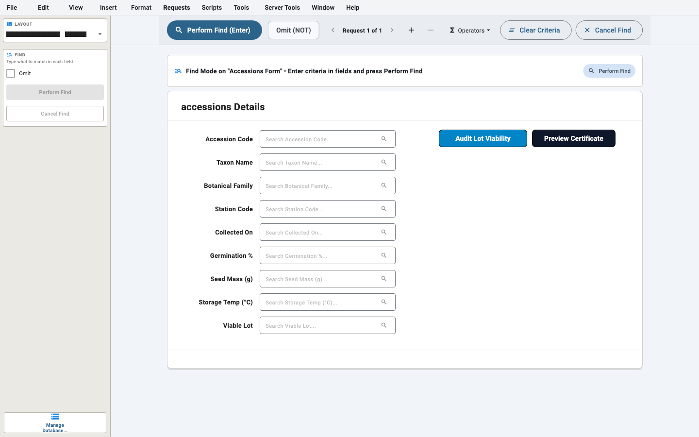

In **Find Mode**, the form layout transforms into a visual query-by-example (QBE) builder:
1. **Criteria within a Single Request (`AND` Logic):** Typing `Pinaceae` into **Botanical Family** and `>90` into **Germination %** within `Request 1` finds all records where `family = 'Pinaceae'` **AND** `germination_pct > 90`.
2. **Multiple Find Requests (`OR` Union):** Click **`+ Add Request`** in the Find toolbar to create `Request 2`. Each additional **Include** request acts as a logical `OR` union with prior requests.
3. **Excluding Records (`Omit` Request):** Toggle the **Include / Omit** switch in the Find toolbar to **`Omit matching records`**. Any record matching an **Omit** request is subtracted from the found set (evaluated sequentially in request order).
4. **Related Field Searches:** You can also type criteria into related fields (`::table_occurrence::field`) or portal fields on the layout to filter parent records by their child rows!
5. Click **`Perform Find`** (or press `Enter`) to execute the query and return to **Browse Mode** with the filtered found set.

### 6.2 Search Operators & Wildcards Reference

Click **`Insert Operator ▾`** in the Find Mode toolbar to insert any of File4Base's built-in query operators into the focused field:

| Operator | Name | Example Criterion | Matching Behavior |
| :--- | :--- | :--- | :--- |
| `=` | Exact / Empty Match | `=` or `=Pinaceae` | Alone (`=`), matches empty/null fields. With text (`=Pinaceae`), matches exact whole-word/field values. |
| `==` | Exact Field Content | `==Pinus sylvestris L.` | Matches only when the entire field equals the exact string. |
| `!` | Duplicates | `!` | Finds all records that have non-unique (duplicate) values in that field. |
| `<` / `<=` | Less Than / Or Equal | `<0` or `<=75` | Numeric, date, or alphabetical comparison. |
| `>` / `>=` | Greater Than / Or Equal | `>=90` | Numeric, date, or alphabetical comparison. |
| `...` | Range | `75...95` or `2026-01-01...2026-12-31` | Matches values inclusively between the lower and upper bounds. |
| `*` | Zero or More Characters | `BOR-2026-*` | Wildcard matching any sequence of zero or more characters. |
| `@` | Single Character | `STN-ABISK@` | Wildcard matching any single character at that position. |
| `?` | Invalid Value | `?` | Finds records containing malformed dates or numbers. |
| `//` | Today's Date | `//` | Dynamically substitutes the current system date (`YYYY-MM-DD`). |
| `""` | Literal Phrase | `"Arctic Station"` | Matches the exact literal phrase inside the field. |
| `\` | Escape Character | `\*` | Escapes a wildcard symbol so it is matched literally. |

### 6.3 Constrain Found Set, Extend Found Set & Saved Finds

- **Modify Last Find (`Cmd+R`):** Re-opens **Find Mode** pre-populated with all requests and criteria from your most recent search so you can refine them.
- **Constrain Found Set:** Runs a new Find request restricted *only* to the records currently in your found set (progressive narrowing / `AND`).
- **Extend Found Set:** Runs a new Find request and merges the newly matched records into your existing found set (progressive widening / `OR`).
- **Saved Finds (`Records > Saved Finds`):** Save complex multi-request `Include`/`Omit` queries by name so any user can re-execute them with a single click.

---

## 7. Schema Engineering: Manage Database

Open **File > Manage > Database...** (`Cmd+Shift+D` / `Ctrl+Shift+D`) or click **Manage Database...** at the bottom of the left Status Sidebar (or inside **Server Tools > Manage > Database...**). The **Manage Database** studio provides four integrated tabs: **Databases**, **Tables**, **Fields**, and **Relationships Graph**.

### 7.1 Multi-Database Catalog (`Databases` Tab)

- Inspect all relational databases hosted on the connected PostgreSQL 16 or MariaDB 11 server.
- View which database is currently **Active** (highlighted in green) and which system databases (`postgres`, `mysql`) are protected.
- Create new databases (`+ New Database...`), switch the active session to another database with one click, or batch-select non-system databases for administrative cleanup.

### 7.2 Table Management & Bulk Operations (`Tables` Tab)

- Create new relational tables (`+ New Table...`) with a human-readable **Display Name** (e.g., `Accessions`) and an optional custom SQL identifier (e.g., `accessions`).
- Select any table to inspect its field count and primary key configuration, **Rename** its display/SQL name, **Duplicate** its schema, or **Delete** tables with confirmation safeguards.

### 7.3 Agnostic Field Types, Calculations & Summaries (`Fields` Tab)

The **Fields** tab displays every column of the selected table, its agnostic type badge, primary key status, nullability, and quick actions (**Options...**, **Duplicate**, **Edit**, **Delete**, plus **Copy / Paste Fields** across tables):

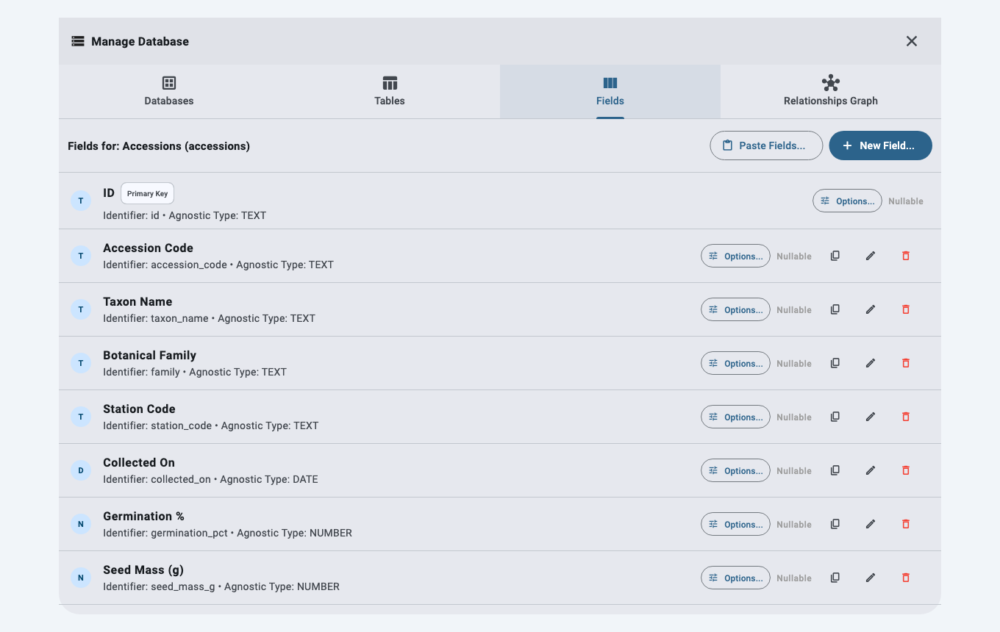

File4Base supports **8 engine-agnostic field types** that map deterministically to PostgreSQL 16 and MariaDB 11 types:

| Agnostic Type | Badge | PostgreSQL 16 Mapping | MariaDB 11 Mapping | Description |
| :--- | :--- | :--- | :--- | :--- |
| **`TEXT`** | `T` | `TEXT` / `VARCHAR` | `TEXT` / `VARCHAR(255)` | UTF-8 strings, codes, notes, and value-list selections. |
| **`NUMBER`** | `N` | `NUMERIC` / `DOUBLE PRECISION` | `DECIMAL` / `DOUBLE` | Integers, decimals, currencies, and percentages. |
| **`DATE`** | `D` | `DATE` | `DATE` | Calendar dates (`YYYY-MM-DD`). |
| **`TIMESTAMP`** | `TS` | `TIMESTAMPTZ` | `DATETIME` | Combined date and time stamps. |
| **`BOOLEAN`** | `B` | `BOOLEAN` | `TINYINT(1)` | True/False flags rendered as checkboxes or switches. |
| **`CONTAINER`** | `C` | `TEXT` / `BYTEA` | `LONGTEXT` / `LONGBLOB` | Images (`PNG`/`JPG`/`SVG`), PDFs, audio/video, and binary files. |
| **`CALCULATION`** | `Σ` | Virtual / Materialized Formula | Virtual / Materialized Formula | Evaluated dynamically by the File4Base Calculation Engine using formulas across local and related fields. |
| **`SUMMARY`** | `Σ` | Aggregate Rollup | Aggregate Rollup | Computes `Total of`, `Average of`, `Count of`, `Minimum`, `Maximum`, `Standard Deviation`, or `Fraction of Total` across the found set or sub-summary break group. |

### 7.4 Field Options: Auto-Enter & Validation Rules

Click **`Options...`** on any field row in the **Fields** tab to configure:
1. **Auto-Enter Tab:**
   - **Creation / Modification Metadata:** Automatically populate `Creation Date`, `Creation Time`, `Creation Timestamp`, `Creator Account Name`, `Modification Date`, `Modification Time`, `Modification Timestamp`, or `Modifier Account Name`.
   - **Serial Number:** Auto-incrementing integer or prefixed code (`BOR-2026-0001`, step by `1`).
   - **UUID:** Automatically generate a v4 UUID on record creation.
   - **Data / Default Value:** Pre-fill a constant string, number, or boolean value.
   - **Calculated Value:** Compute an initial value using a formula (optionally re-evaluated whenever referenced fields change).
   - **Looked-up Value:** Copy a field value from a related table occurrence when the foreign key changes.
2. **Validation Tab:**
   - Require **Not Empty** (`NOT NULL`), **Unique Value**, **Existing Value**, **Member of Value List**, **Strict Data Type** (`Numeric Only`, `4-Digit Year Date`), **Maximum Character Length**, **Value Range** (`min` to `max`), or **Validated by Calculation** with a custom error alert message.

### 7.5 Interactive Relationships Graph & Table Occurrences

Switch to the **Relationships Graph** tab in **Manage Database** to model your entity-relationship architecture visually:

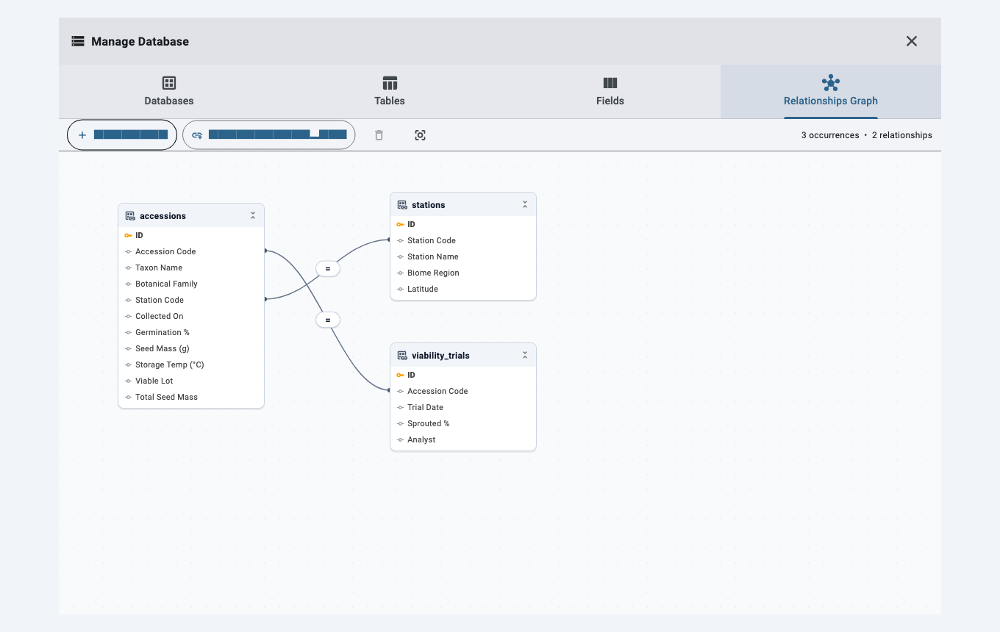

- **Table Occurrences (TOs):** Each node on the graph is a **Table Occurrence** referencing a base table (e.g., `accessions`, `stations`, `viability_trials`). You can add multiple occurrences of the same base table (`+ Add Occurrence...`) to model self-joins or distinct relational paths.
- **Creating & Editing Relationships:**
  - Drag a connector wire directly from a field port on one Table Occurrence (such as `accessions::station_code`) to the matching key field on another Table Occurrence (`stations::station_code`), or click **`New Relationship...`**.
  - Click the operator badge (`=`, `≠`, `<`, `≤`, `>`, `≥`) on any relationship curve to inspect or edit the join predicate, enable **Allow creation of records in this table via this relationship**, or enable **Delete related records in this table when a record is deleted in the other table** (cascading delete).
- **Canvas Controls:** Pan and zoom smoothly, drag nodes to organize your graph (positions are saved automatically), or click the **Auto-Arrange / Fit** icon in the toolbar.

---

## 8. Visual Layout Studio: Layout Mode

### 8.1 WYSIWYG Canvas, 96px Horizontal Part Rail & Rulers

Press `Cmd+L` / `Ctrl+L` (or select **View > Layout Mode**) to open the **Visual Layout Studio**:

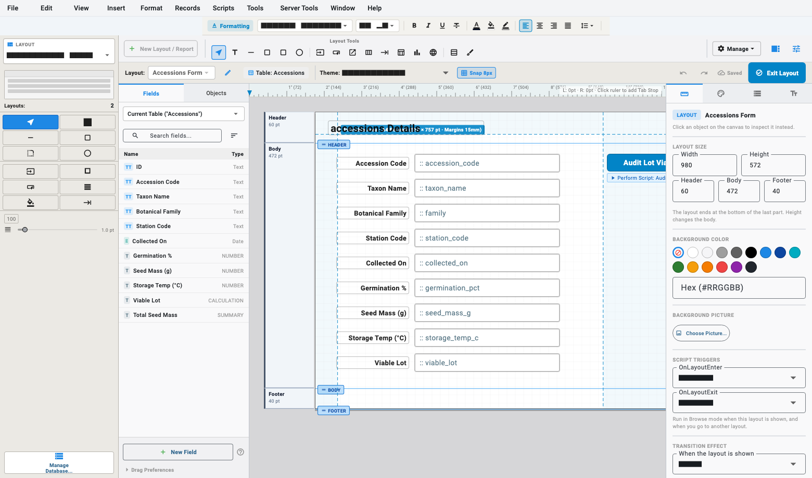

The Layout Mode workspace comprises five coordinated zones:
1. **Top Layout Toolbars:**
   - **Formatting Bar:** Quick font family, font size, bold/italic/underline/strikethrough, text color, fill color, and paragraph alignment controls.
   - **Layout Tools Bar:** Pointer selection tool, Text tool (`T`), Line, Rectangle, Rounded Rectangle, Oval, Field, Button, Popover Button, Tab Control, Slide Control, Portal, Chart, Web Viewer, Picture, Part tool, and Eyedropper style copier, plus the **Manage ▾** quick-menu and panel toggles.
   - **Context & Theme Bar:** Layout switcher dropdown, inline layout rename button, base **Table Occurrence** selector (`Table: Accessions`), **Theme** selector, **Snap 8px** grid toggle, Undo/Redo, Save status, and **`Exit Layout`** button.
2. **Left Field Picker & Objects Hierarchy (`Fields` / `Objects` Tabs):**
   - **Fields Tab:** Switch between `Current Table`, related Table Occurrences, or all tables; search fields; and drag-and-drop any field directly onto the canvas (choosing label placement under `Drag Preferences` at the bottom). Click **`+ New Field`** to create a schema column without leaving Layout Mode.
   - **Objects Tab:** Inspect the Z-order layer tree of every object on the layout, toggle visibility or lock state, and select overlapping elements.
3. **96px Horizontal Part Rail (`_kPartRailWidth = 96.0`):**
   - Located immediately to the left of the canvas, the dedicated `96pt` rail displays each layout part's name (`Header`, `Body`, `Sub-Summary`, `Footer`) and exact height in points (`60 pt`, `472 pt`, `40 pt`) horizontally so part badges never obscure canvas objects. Drag the bottom border of any part row to resize its height interactively.
4. **Central WYSIWYG Canvas with Rulers & Page Margins:**
   - Displays the interactive **Text Ruler** with draggable `L`/`R` indents and tab stops, dashed blue **Printable Page Margin** boundaries (e.g., `A4 Portrait • 510 × 757 pt • Margins 15mm`), and `8px` snap guides.
5. **Right Property Inspector (4 Tabs):**
   - **Position & Size (`Ruler` icon)**, **Appearance & Style (`Palette` icon)**, **Data & Behavior (`List` icon)**, and **Typography (`Tt` icon)**.

### 8.2 New Layout / Report Assistant

Click **`+ New Layout / Report`** in the Layout Mode toolbar (or choose **Layouts > New Layout / Report...**) to launch the guided **New Layout Assistant**:

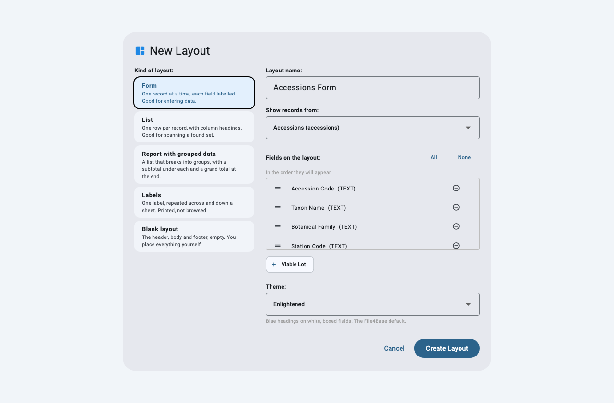

Choose the target **Table Occurrence**, enter a **Layout Name**, and pick from five specialized layout archetypes:
1. **Form:** Single-record detail canvas with auto-arranged field labels and inputs.
2. **List:** Multi-record vertical scrolling list with compact row bands and column headers.
3. **Report:** Multi-step wizard allowing you to include **Grouped Data with Sub-Summaries**, **Subtotals**, and **Grand Totals**, choose which fields to display, specify break fields for grouping, define sort order, and pick a header/footer template.
4. **Labels:** Multi-column mailing or specimen label layout with customizable label presets (Avery standards or custom dimensions in `mm` / `in` / `pt`, across $1\text{–}4$ columns).
5. **Blank Layout:** Empty Header/Body/Footer canvas for custom freeform design.

### 8.3 Layout Parts (`Header`, `Body`, `Sub-Summary`, `Grand Summary`, `Footer`)

Click **`Insert > Part...`** or use the Part tool in the toolbar to add or modify layout bands:
- **Title Header / Header:** Rendered at the top of the first page or every page/screen.
- **Leading Grand Summary:** Displays aggregate summary fields across the entire found set above the body rows.
- **Sub-Summary (When Sorted By *Break Field*):** Placed above (Leading) or below (Trailing) the **Body** part. When the found set is sorted by the specified break field (e.g., `Botanical Family`), File4Base groups records by each distinct value of that field and evaluates `SUMMARY` fields (subtotals, group averages, group counts) per group.
- **Body:** Repeated once per record in the found set (or across $N$ columns when multi-column printing is enabled).
- **Trailing Grand Summary:** Displays grand totals at the end of the report.
- **Footer / Title Footer:** Rendered at the bottom of every page or the first page.

### 8.4 Tool Palette, Objects, Merge Fields & Value Lists

- **Interactive Field Control Styles:** Select any field on the canvas and open the Inspector's **Data** tab to render it as an **Edit Box**, **Drop-Down List**, **Pop-Up Menu**, **Checkbox Set**, **Radio Button Set**, **Drop-Down Calendar**, or **Concealed Edit Box (Password)**.
- **Value Lists (`File > Manage > Value Lists...`):** Bind dropdowns, radio buttons, or checkboxes either to a static list of custom values or dynamically to values from a database field (`table::column`).
- **Buttons & Button Bars:** Bind a button to a single step (`Go to Layout`, `New Record`, `Delete Record`, `Perform Find`, `Sort Records`, `Open URL`, `Show Custom Dialog`) or to a full script from the **Script Workspace** (`Perform Script`), with an optional script parameter (`$scriptParam`).
- **Tab Controls, Slide Controls & Popover Buttons:** Organize dense forms into multi-tab containers, swipeable slide panels, or floating popovers without cluttering the main canvas.
- **Merge Fields & Merge Variables:** Insert `<<table::field>>` or `<<$variable>>` (plus system symbols like `{{CurrentDate}}`, `{{PageNumber}}`, `{{RecordNumber}}`, `{{FoundCount}}`, and `{{CurrentUserName}}`) inside any text block for dynamic mail-merge and report headers.

### 8.5 Property Inspector (Position, Style, Data & Appearance)

With no object selected, the Inspector configures the **Layout** itself (canvas width/height, part heights, background color or image, `OnLayoutEnter` / `OnLayoutExit` / `OnRecordLoad` script triggers, and layout transition animations). When one or more objects are selected:
- **Tab 1 — Position & Geometry:** Exact `X`, `Y`, `Width`, and `Height` in points, Z-order arrangement (`Bring to Front`, `Send to Back`), multi-object alignment (`Align Left/Center/Right`, `Align Top/Middle/Bottom`, `Distribute Horizontally/Vertically`), and **Auto-Resize Anchors** (`Left`, `Top`, `Right`, `Bottom`) for responsive window scaling.
- **Tab 2 — Appearance & Borders:** Fill color, border color, stroke width, corner radius (`px`), drop shadow, inner padding, and **Conditional Formatting** rules (changing text/fill color dynamically when a calculation formula evaluates to true).
- **Tab 3 — Data Binding & Behavior:** Field binding (`table_occurrence::column`), control style, value list assignment, placeholder text, **Hide object when** calculation formula, tooltip calculation, and field entry permissions (`Browse Mode` vs. `Find Mode`).
- **Tab 4 — Typography:** Font family, point size, weight, text color, horizontal/vertical alignment, line height, and text orientation (`Horizontal`, `Sideways 90°`, `Vertical stacked`).

### 8.6 Integrated Analytics & Chart Views

File4Base includes a native vector charting engine (`ChartView`) that can be embedded directly on any layout or opened as a dedicated chart layout:

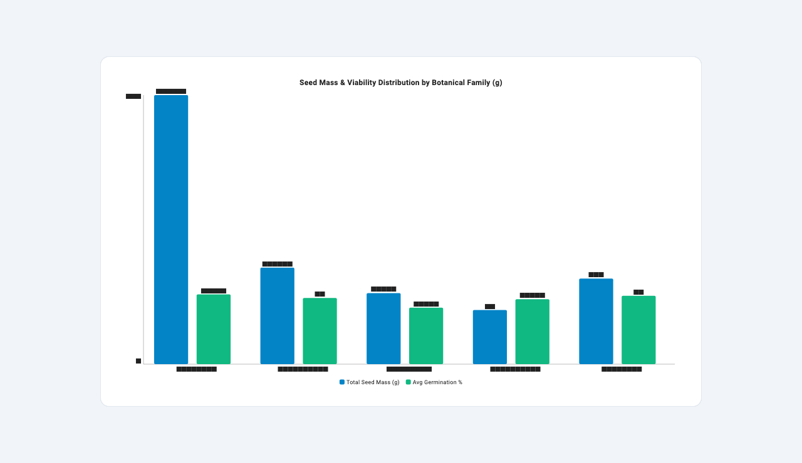

Supported chart types include:
- **Column Chart** & **Stacked Column Chart**
- **Bar Chart (Horizontal)**
- **Line Chart** & **Area Chart**
- **Pie Chart** & **Donut Chart**
- **Scatter Plot**

Charts bind directly to the active found set or related records, supporting multi-series comparisons, custom hex palettes, category grouping, and built-in data aggregation (`Sum`, `Average`, `Count`, `Min`, `Max`).

### 8.7 Layout Themes & Cross-Solution Copy/Paste

- **Layout Themes (`Format > Change Theme...`):** Apply coordinated color, surface, border, and typography palettes across an entire layout in one click (including `Apex Blue`, `Minimalist Light`, `Obsidian Dark`, `Warm Parchment`, and `High Contrast`).
- **Cross-Solution Structure Copy/Paste:** Copy fields, tables, layout objects, or script steps to the system clipboard as deterministic JSON blueprints and paste them into another layout or even another File4Base solution window.

---

## 9. Printing, Page Setup & Preview Mode

### 9.1 Page Setup & Printable Margin Guides

Open **File > Page Setup...** to configure the physical page geometry for the active solution:
- **Paper Size:** `A4 (210 × 297 mm)`, `US Letter (8.5 × 11 in)`, `US Legal (8.5 × 14 in)`, `A3`, `A5`, or `Tabloid`.
- **Orientation:** `Portrait` or `Landscape`.
- **Margins:** Configurable `Top`, `Bottom`, `Left`, and `Right` margins in millimeters (`mm`) or points (`pt`).
- Enabling **View > Page Margins** in **Layout Mode** overlays the exact printable area (`PageSetupModel.printableWidthPt` $\times$ `printableHeightPt`) on the design canvas so you can see where page breaks will occur.

### 9.2 Preview Mode, Grouped Reports & Multi-Column Labels

Press `Cmd+U` / `Ctrl+U` (or choose **View > Preview Mode**) to inspect the rendered print sheets:

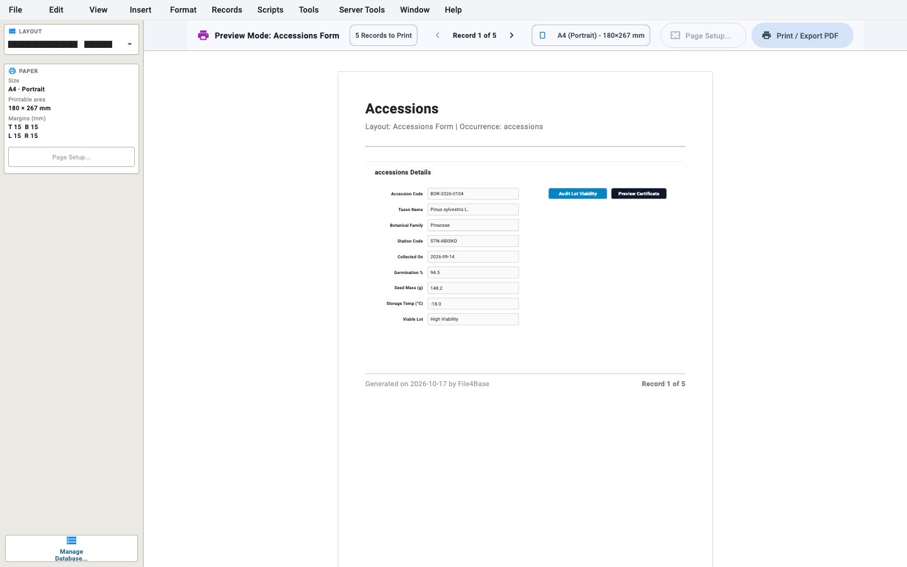

In **Preview Mode**:
- **Live System Symbols & Merge Fields:** `{{PageNumber}}`, `{{CurrentDate}}`, `{{RecordNumber}}`, and `<<field>>` tokens resolve to their live printed values.
- **Grouped Sub-Summary Pagination:** When the found set is sorted by a `Sub-Summary` break field, File4Base renders each group header, its detail `Body` rows, its trailing subtotal band, and the final `Grand Summary` across paginated sheets.
- **Multi-Column Label Sheets:** Layouts configured with $2\text{–}4$ columns render records across and down (or down and across) matching the exact label pitch and gutter settings.
- Click **File > Print...** (`Cmd+P` / `Ctrl+P`) to send the paginated output to a physical printer or save as a vector PDF document.

---

## 10. Automation & Calculations: Script Workspace, Debugger & Data Viewer

### 10.1 3-Panel Script Workspace IDE

Open **Scripts > Script Workspace...** (`Cmd+Shift+S` / `Ctrl+Shift+S`) or **File > Manage > Scripts...** to build automated workflows:

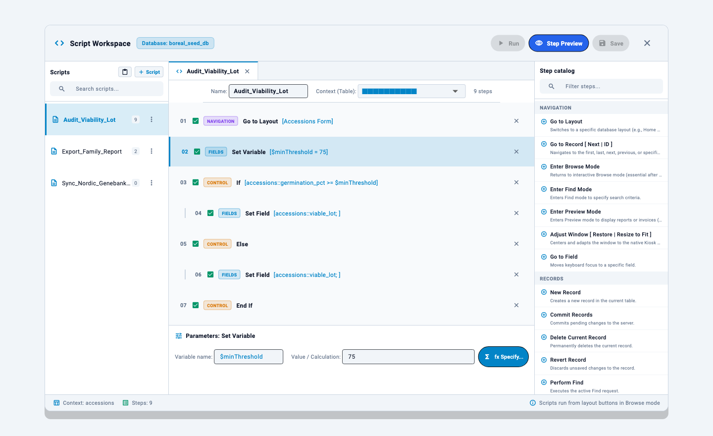

The **Script Workspace** provides a 3-panel IDE:
1. **Left Panel — Scripts Explorer:** Search scripts, create new scripts (`+ Script`), duplicate or delete existing scripts, and copy/paste scripts across solutions.
2. **Center Panel — Sequential Step Editor & Parameter Inspector:**
   - Displays the numbered sequence of script steps with automatic block indentation for `If` / `Else If` / `Else` / `End If` and `Loop` / `Exit Loop If` / `End Loop` control structures.
   - Each step has an enable/disable checkbox, a color-coded category pill (`NAVIGATION`, `FIELDS`, `CONTROL`, `RECORDS`, `FOUND SET`, `DIALOGS`), and inline parameter summary.
   - Selecting any step opens its **Parameters** editor at the bottom of the center panel, with direct access to **`fx Specify...`** (the Calculation Formula Builder).
3. **Right Panel — Step Catalog:** Filterable library of all built-in script steps. Click or double-click any step in the catalog to append or insert it into the active script.

### 10.2 Built-In Script Steps Catalog

| Category | Script Step | Parameters & Behavior |
| :--- | :--- | :--- |
| **Navigation** | `Go to Layout` | Switches the workspace to a target layout by name or ID. |
| **Navigation** | `Go to Record/Request/Page` | Navigates to `First`, `Last`, `Previous`, `Next`, or a specific record index/calculation. |
| **Navigation** | `Enter Browse Mode` / `Enter Find Mode` / `Enter Preview Mode` | Transitions the studio to the specified operational mode. |
| **Navigation** | `Adjust Window` | Restores, maximizes, minimizes, or `Resize to Fit` (centers and adapts window to layout bounds). |
| **Navigation** | `Go to Field` | Moves keyboard focus to a target field on the layout. |
| **Fields & Variables** | `Set Field` | Evaluates a calculation formula and writes the result to `table::field` on the active record. |
| **Fields & Variables** | `Set Variable` | Assigns a calculation result to a local script variable (`$var`) or global session variable (`$$GLOBAL_VAR`). |
| **Fields & Variables** | `Replace Field Contents` | Batch-updates a field across all records in the found set. |
| **Control Flow** | `If` / `Else If` / `Else` / `End If` | Conditional branching evaluated by the Calculation Engine. |
| **Control Flow** | `Loop` / `Exit Loop If` / `End Loop` | Iterative loop execution with boolean exit condition and iteration safety guard. |
| **Control Flow** | `Perform Script` | Calls a sub-script with an optional parameter (`Get(ScriptParameter)`). |
| **Control Flow** | `Exit Script` | Terminates the current script and returns an optional text/calculation result (`Get(ScriptResult)`). |
| **Control Flow** | `Pause/Resume Script` | Pauses execution for a specified duration in seconds or until user confirmation. |
| **Records** | `New Record/Request` | Creates a new record in Browse Mode or a new Find request in Find Mode. |
| **Records** | `Duplicate Record/Request` | Duplicates the current record or Find request. |
| **Records** | `Delete Record/Request` | Deletes the active record (with optional `With dialog: On/Off`). |
| **Records** | `Commit Records/Requests` | Persists all pending record modifications to the server. |
| **Records** | `Revert Record/Request` | Discards uncommitted edits on the current record. |
| **Found Set** | `Perform Find` | Executes a stored or active Find query. |
| **Found Set** | `Show All Records` | Resets the found set to include all rows in the table. |
| **Found Set** | `Show Omitted Only` | Inverts the current found set, displaying only omitted rows. |
| **Found Set** | `Omit Record` / `Omit Multiple Records` | Hides the current record (or $N$ records) from the found set without deleting from the database. |
| **Found Set** | `Sort Records` | Sorts the found set by one or more fields ascending/descending. |
| **Dialogs & I/O** | `Show Custom Dialog` | Displays a modal alert with custom title, message formula, and button labels. |
| **Dialogs & I/O** | `Open URL` | Opens an HTTP/HTTPS URL or `mailto:` link calculated from record data. |
| **Dialogs & I/O** | `Print` / `Export Records` / `Import Records` | Triggers printing, data export, or data import pipelines. |

### 10.3 Calculation Formula Builder & 20-Function Engine

Whenever you define a `CALCULATION` field, a `Set Field` / `Set Variable` script step, a `If` / `Exit Loop If` condition, a `Hide object when` rule, or a **Data Viewer** watch expression, click **`fx Specify...`** to open the **Specify Calculation** dialog:

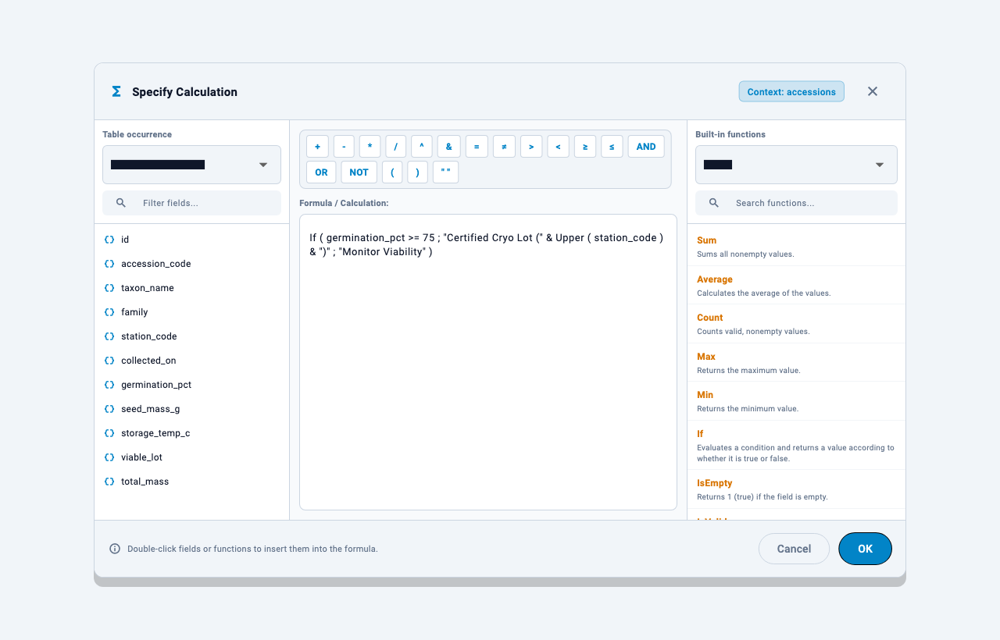

- **Left Pane — Table Occurrences & Fields:** Pick any table occurrence (`accessions`, `stations`, `viability_trials`) and double-click a field to insert its reference into the formula editor.
- **Center Pane — Formula Editor & Operator Keypad:** Write formulas using standard mathematical (`+`, `-`, `*`, `/`, `^`), string concatenation (`&`), comparison (`=`, `≠`, `<`, `>`, `≤`, `≥`), and logical (`AND`, `OR`, `NOT`) operators. Both semicolons (`;`) and commas (`,`) are supported as argument separators.
- **Right Pane — Categorized Function Catalog:** Search or filter by category (`All`, `Text`, `Number`, `Date`, `Logical`, `Aggregate`) and double-click any function to insert its template:

| Category | Built-In Functions (20 Core Functions + System Getters) |
| :--- | :--- |
| **Text (7)** | `Upper ( text )`, `Lower ( text )`, `Trim ( text )`, `Length ( text )`, `Left ( text ; count )`, `Right ( text ; count )`, `Substitute ( text ; searchString ; replaceString )` |
| **Number (5)** | `Round ( number ; precision )`, `Abs ( number )`, `Int ( number )`, `Mod ( number ; divisor )`, `Random` |
| **Date & Time (5)** | `GetCurrentDate`, `GetCurrentTimestamp`, `Year ( date )`, `Month ( date )`, `Day ( date )` |
| **Logical (3)** | `If ( test ; resultOne ; resultTwo )`, `Case ( test1 ; result1 ; [ test2 ; result2 ; ... ] ; defaultResult )`, `IsEmpty ( value )` |
| **Aggregate & Context** | `Sum ( field )`, `Average ( field )`, `Count ( field )`, `Min ( field )`, `Max ( field )`, `Get ( AccountName )`, `Get ( FoundCount )`, `Get ( RecordNumber )`, `Get ( ScriptParameter )`, `Get ( ScriptResult )` |

### 10.4 Interactive Step-by-Step Script Debugger & Data Viewer

File4Base provides two dedicated pro-developer diagnostic tools under the **`Tools`** menu:

#### 1. Interactive Script Debugger (`Tools > Script Debugger...`)
Also accessible by clicking **`Step Preview`** inside the **Script Workspace**:
- **Step Controls:** `Step Into / Next Step` (`F10`), `Run to Completion / Next Breakpoint` (`F5`), `Restart Script`, and `Halt Script` (`Shift+F5`).
- **Breakpoints:** Click the left gutter of any script line to toggle a red **Breakpoint** dot. Execution pauses automatically before executing a breakpointed line.
- **Live Variable & Call Stack Inspection:** Watch local (`$var`) and global (`$$VAR`) variables mutate after every single step alongside the step execution log.

#### 2. Interactive Data Viewer (`Tools > Data Viewer...`)
Open **Tools > Data Viewer...** at any time to inspect the current record's field values and test live calculation expressions against the server (`POST /api/v1/data/{table}/evaluate`):

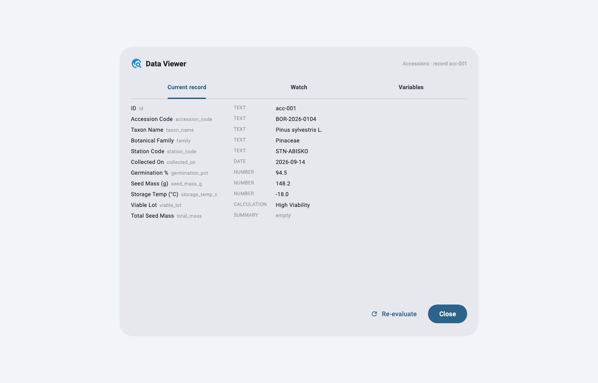

- **`Current` Tab:** Displays every field in the active record, its agnostic type, and its current live value.
- **`Watch` Tab:** Add arbitrary calculation expressions (or build them via the `fx` button) and click **Evaluate All** to inspect the exact server-computed result in real time.

---

## 11. Security, RBAC, TOTP 2FA & Super-Owner Governance

Open **File > Manage > Security...** (or **Server Tools > Manage > Security...**) to manage database accounts, privilege sets, multi-factor authentication, layout permissions, table permissions, and server-wide Super-owner privileges:

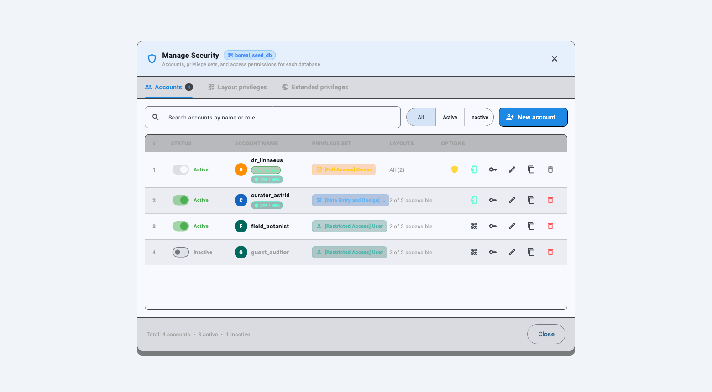

### 11.1 Account Roles (`Owner`, `Admin`, `User`) & Privilege Sets

Every database has its own isolated account table (`_file4base_users`) with bcrypt-hashed passwords and three built-in privilege sets:

| Role Identifier | Privilege Set Label | Capabilities |
| :--- | :--- | :--- |
| **`owner`** | `[Full Access] Owner` | Full control over the database: create/alter/drop tables and fields, edit layouts and scripts, manage security accounts, run backups, and bypass Kiosk Mode lockout. The last active `owner` account in a database cannot be deleted or demoted. |
| **`admin`** | `[Data Entry and Design] Admin` | Can create and modify layouts, value lists, scripts, and records, and bypass Kiosk Mode for solution programming, subject to table/layout overrides. |
| **`user`** | `[Restricted Access] User` | Data-entry and browsing role. Cannot modify database schemas, layouts, scripts, or security accounts. Automatically locked into full-screen Kiosk UI when **Kiosk Mode** is enabled on the solution. |

### 11.2 Super-Owner Privilege Switch & Server-Wide Delegation

While a standard `owner` controls their own database, a **Super-Owner** holds **server-wide administrative authority** across the entire File4Base instance (all 9 modules of **Server Tools**, container restarts, ACME SSL/TLS certificates, cron schedules, and all hosted databases):

1. **Seeding the First Super-Owner:**
   - Set `FILE4BASE_SUPER_OWNER=boreal_seed_db:dr_linnaeus` (or a bare username `admin`) in `.env` at server startup, **or**
   - If the SQLite control store (`server_control.sqlite`) has zero Super-owners yet, the first `owner` who logs in (from `FILE4BASE_ADMIN_DATABASE` if set, or from any database otherwise) may promote accounts in **Manage Security**.
2. **Granting or Revoking Super-Owner in Manage Security:**
   - **Quick Shield Toggle in Accounts Table:** Click the **shield icon** in the `OPTIONS` column of any Owner row (gold shield = active Super-owner; outlined shield = standard Owner) to grant or revoke server-wide control immediately.
   - **Switch Inside Edit Account Dialog:** Click the edit pencil (`Edit account`) on *any* user account (`owner`, `admin`, or `user`) to see the **Super-owner (full server control)** toggle switch. Turning it on for an `admin` or `user` account automatically promotes that account to `[Full Access] Owner` and records the grant in the server control store.
   - **Self-Lockout Guard:** A Super-owner cannot accidentally revoke their own Super-owner status from their own active session; another Super-owner must revoke it.

### 11.3 Google Authenticator TOTP 2FA Enrollment & Enforcement

Any account can be protected with **RFC 6238 Time-Based One-Time Password (TOTP)** two-factor authentication:
1. In **Manage Security > Accounts**, click the **QR / Phone Lock icon** (`Activate MFA with Google Authenticator`) on any account row.
2. File4Base calls `POST /api/v1/users/{id}/mfa/setup` to generate a cryptographically random 160-bit Base32 secret and renders a scannable **QR Code** (`otpauth://totp/File4Base:...`) plus the manual secret key.
3. Scan the QR code with **Google Authenticator** (or any TOTP app) and enter the 6-digit verification code to confirm enrollment (`POST /api/v1/users/{id}/mfa/enable`).
4. Once enabled, the account row displays a teal **`2FA / MFA`** badge, and every subsequent login for that user requires both their password and a valid 6-digit TOTP code.

### 11.4 Per-Layout & Per-Table Granular Permissions

When editing an account (or inside the **Layout privileges** tab of **Manage Security**), you can configure fine-grained access rules per user:
- **Per-Layout Access (`_file4base_layout_permissions`):** Set each layout to **`Read and Write`** (`read_write`), **`Read Only`** (`read_only`), or **`No Access`** (`none`). Layouts marked `none` are hidden from the user's layout selector; layouts marked `read_only` disallow field editing in Browse Mode.
- **Per-Table CRUD Matrix (`_file4base_table_permissions`):** Independently toggle **`View (SELECT)`**, **`Create (INSERT)`**, **`Edit (UPDATE)`**, and **`Delete (DELETE)`** permissions for every table in the database. These privileges are enforced server-side on every REST API call (`GET / POST / PUT / DELETE /api/v1/data/{table}`).

### 11.5 Extended Privileges & Brute-Force Rate Limiting

- **Extended Privileges Tab:** Controls whether `admin` and `user` roles are permitted to perform bulk operations such as `Export Records`, `Import Records`, and `REST API Direct Access`.
- **Login Rate Limiter:** The API server enforces a sliding-window brute-force limiter per client IP (`5 failed attempts` within `60 seconds` triggers a `429 Too Many Requests` cooldown with `Retry-After` headers and logs an entry in the **Audit & Security Logs**).

---

## 12. Developer Utilities, Kiosk Mode, Encryption & Migration

### 12.1 Cloning, Renaming & Permanent Design Lock

Open **Tools > Developer Utilities...** to package, clone, rename, encrypt, or harden your solution:

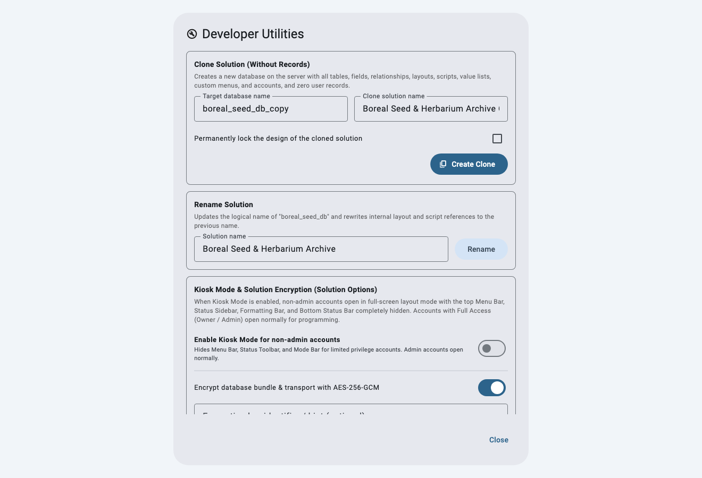

- **Clone Solution (Without Records):** Creates a brand-new database on the server copying 100% of tables, fields, relationships, layouts, scripts, value lists, custom menus, and accounts while leaving all user data tables empty (`0 records`).
- **Permanently Lock Design of Cloned Solution:** Checking **Permanently lock the design of the cloned solution** strips schema/layout modification privileges on the target clone (`design_locked: true`), ideal for distributing tamper-proof production builds.
- **Rename Solution:** Updates the logical solution display name and rewrites internal layout and script metadata references cleanly.

### 12.2 Kiosk Mode & Pre-Flight Readiness Check

**Kiosk Mode** turns a File4Base solution into a dedicated, full-screen line-of-business or point-of-sale application:
1. **Conditional Role-Based Lockout:**
   - When **Enable Kiosk Mode for non-admin accounts** is turned on in **Developer Utilities**, any user logging in with the `user` (`[Restricted Access]`) role opens directly in a locked-down Kiosk shell: the top Menu Bar, Status Sidebar, Formatting Bar, Mode Switcher, and keyboard design shortcuts (`Cmd+L`, `Cmd+Shift+D`, `Cmd+Shift+S`) are completely hidden, and the window automatically resizes and centers to fit the active layout's exact dimensions.
   - Accounts with `[Full Access] Owner` or `[Data Entry and Design] Admin` privileges continue to open the normal studio workspace so developers can maintain layouts and scripts without locking themselves out.
   - Developers can preview the exact Kiosk experience at any time by clicking the **Kiosk Preview** toggle button in the top menu bar.
2. **Kiosk Mode Readiness Check (`Tools > Kiosk Mode Readiness Check...`):**
   - Audits your solution before enabling Kiosk Mode, verifying that a startup layout is assigned, navigation buttons exist between layouts (since the top menu bar will be hidden for end users), and at least one non-admin account is configured.

### 12.3 AES-256-GCM Transport & Bundle Encryption

In **Developer Utilities**, toggle **Encrypt database bundle & transport with AES-256-GCM**:
- **Encrypted `.f4p` Solution Bundles:** Local `.f4p` project exports are encrypted at rest using **AES-256-GCM** with a PBKDF2-derived key from your encryption passphrase.
- **Encrypted API Transport Channel:** When an encryption key is configured between the client and `file4base-api`, request and response JSON bodies are wrapped in an authenticated AES-256-GCM envelope (`{"encrypted": true, "nonce": "...", "ciphertext": "..."}`), indicated by the green **`Encrypted Channel (AES-256-GCM)`** shield in the status footer.

### 12.4 Import/Export Records & External SQL Data Sources

Open **File > Import Records > From File (CSV, TSV, Excel, XML)...** to launch the interactive field-mapping importer:

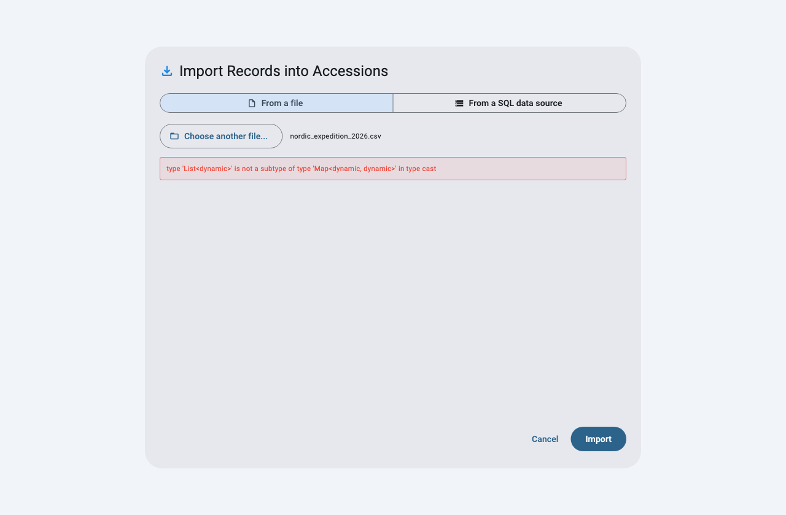

- **Supported Import Formats:** `CSV`, `TSV`, Microsoft Excel (`.xlsx` with multi-sheet picker), and `XML` (including FileMaker `FMPXMLRESULT` grammars).
- **Interactive Column Mapping & Live Preview:** Inspect the first rows of the source file, toggle **Use first row as field names**, and map each source column to a target File4Base field (or set it to `-- Do not import --`).
- **External SQL Data Sources (`File > Manage > External Data Sources...`):** Register external **PostgreSQL**, **MariaDB / MySQL**, or **SQL Server** databases, test connectivity (`POST /api/v1/external-sources/test`), browse remote tables, and import external SQL query results directly into your File4Base tables.
- **Export Records (`File > Export Records...`):** Export the active found set (choosing exactly which fields to include and their export order) to `CSV`, `TSV`, `JSON`, `XML`, `HTML Table`, or `.xlsx`.

### 12.5 Database Design Report (DDR) & Assisted FileMaker Migration

- **Database Design Report (`Tools > Database Design Report...`):** Generates a comprehensive blueprint of your solution's tables, fields, relationships, layouts, scripts, value lists, and security accounts in **Interactive HTML**, **XML**, or **JSON** format for auditing and documentation.
- **Assisted FileMaker Migration (`File > Import Records > FileMaker Solution...` or `Tools > FileMaker Migration Assistant...`):**


  - Upload a FileMaker **XML DDR / Save as XML** blueprint (or HTML DDR report) alongside optional `.fmp12` / CSV / `FMPXMLRESULT` data files.
  - File4Base parses base tables, field types, calculations, table occurrences, relationship joins, value lists, scripts, and multi-part layouts (`Header`, `Body`, `Sub-Summary`, `Footer` with coordinates, styles, portals, and tab controls), provisions the native PostgreSQL/MariaDB schema, and imports your records in a single guided workflow.


---

## 13. Server Tools Administration Console

Open **Server Tools** from the top menu bar to launch the **Server Tools & Administration** console (`ServerToolsDialog`).

### 13.1 Integrated `Manage` Menu & Access Control

- **Role-Based Visibility:**
  - **Super-Owners** (and Owners of `FILE4BASE_ADMIN_DATABASE` when no Super-owner is seeded) have access to all **9 server-wide modules** (`Containers & Services`, `Backups & Snapshots`, `Domain & SSL/TLS`, `API Telemetry & Charts`, `Connected Clients`, `Scheduled Tasks`, `Audit & Security Logs`, `Database Maintenance`, and `Alerts, SMTP & Webhooks`).
  - **Database Owners** of individual databases have access to **`Backups & Snapshots`** and **`Database Maintenance`** scoped strictly to their own active database, plus the **`Manage`** section.
- **Integrated `Manage` Section:** Both the top `Server Tools > Manage` menu and the bottom-left **MANAGE** panel inside the Server Tools console let you jump straight to `Database...`, `Security...`, `Value Lists...`, `External Data Sources...`, `Layouts...`, `Scripts...`, and `Custom Menus...` without closing your administrative workflow.

### 13.2 Module 1: Docker Containers, Updates & Live Logs

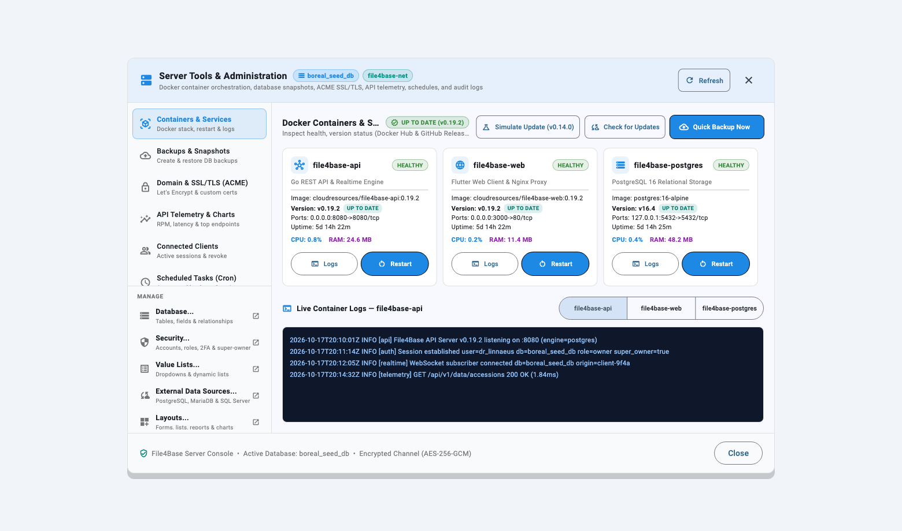

- **Container Health Cards:** Inspect live status (`HEALTHY` / `RUNNING`), image tags (`cloudresources/file4base-api:0.19.2`, `cloudresources/file4base-web:0.19.2`, `postgres:16-alpine`), port bindings, uptime, CPU %, and RAM usage for every container in the stack.
- **Automated Version Watcher (`Check for Updates`):** Polls Docker Hub and GitHub Releases (`POST /api/v1/server/containers/check-updates`) to detect newer stack versions, displays release notes, and provides one-click pre-update snapshots and deployment scripts. You can also test the update workflow at any time via **Simulate Update**.
- **Container Restart & Live Logs:** Restart individual services (`POST /api/v1/server/containers/{name}/restart`) or stream live stdout/stderr container logs (`GET /api/v1/server/containers/{name}/logs`) in the integrated dark terminal viewer.

### 13.3 Module 2: Backups & Snapshots (`.tar.gz` / `.f4b.json`)

- **Create Instant Snapshot:** Captures all user tables, rows, schemas, layouts, scripts, value lists, and security metadata of the selected database into a timestamped snapshot (`POST /api/v1/server/backups`).
- **Download `.tar.gz` Archive:** Downloads any server backup as a compressed `.tar.gz` bundle containing both the `.f4b.json` snapshot and a `manifest.json` checksum file (`GET /api/v1/server/backups/{id}/download`).
- **Upload Backup from Disk:** Upload a previously downloaded `.tar.gz` or `.f4b.json` file (`POST /api/v1/server/backups/upload`) to register it on any File4Base server.
- **Point-in-Time Restore:** Restore a snapshot into the active database or into a brand-new target database (`POST /api/v1/server/backups/{id}/restore`).

### 13.4 Module 3: Domain & SSL/TLS (ACME Let's Encrypt / ZeroSSL)

- Configure the server's public domain name, public URL, and TLS mode (`Self-Signed Local`, `ACME Automated Let's Encrypt / ZeroSSL`, or `Custom PEM Certificate & Private Key`).
- Issue or renew certificates (`POST /api/v1/server/tls/renew`) and inspect certificate subject, issuer, SHA-256 fingerprint, and expiration countdown.

### 13.5 Module 4: Live API Telemetry & 60-Minute Traffic Charts

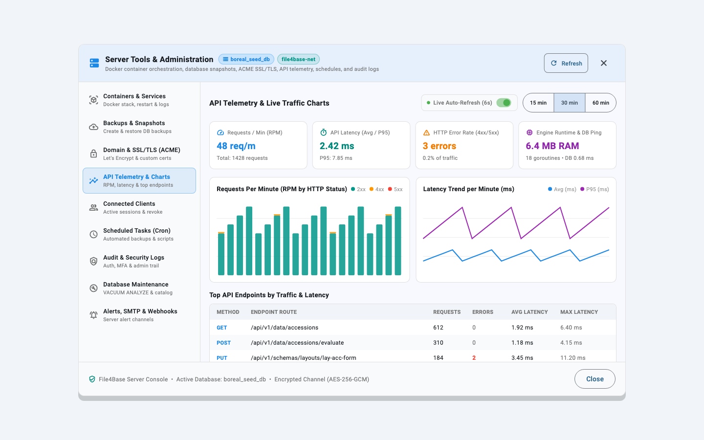

- **Real-Time KPI Cards:** Monitor live **Requests / Min (RPM)**, **Average & P95 API Latency (`ms`)**, **HTTP 4xx/5xx Error Rate**, and **Go Runtime Memory & DB Ping (`ms` + Goroutine count)**.
- **Rolling 15 / 30 / 60-Minute Charts:**
  - **Requests Per Minute Bar Chart:** Color-coded stacked bars showing `2xx` (green), `4xx` (amber), and `5xx` (red) traffic per minute.
  - **Latency Trend Line Chart:** Dual-line chart plotting `Avg (ms)` and `P95 (ms)` response times per minute.
- **Top API Endpoints Table:** Ranks routes by request volume, error count, average latency, and max latency, with a 6-second **Live Auto-Refresh** toggle.

### 13.6 Modules 5–9: Sessions, Cron Schedules, Audit Logs, Maintenance & Alerts

- **Module 5 — Connected Clients & Sessions:** View all active Bearer token sessions (`Username`, `Database`, `Role`, `Client IP`, `User-Agent`, `Issued At`, `Last Seen`) and revoke individual sessions or all sessions for a user immediately (`DELETE /api/v1/server/sessions/{id}`).
- **Module 6 — Scheduled Tasks (Cron):** Schedule recurring automated database backups (`0 2 * * *`), `VACUUM ANALYZE` maintenance jobs, or server scripts, and trigger any job on demand (`Run Now`).
- **Module 7 — Audit & Security Logs:** Filterable, exportable security trail recording logins, failed authentication attempts, TOTP 2FA enrollments, Super-owner grants/revocations, backups, restores, and schema changes.
- **Module 8 — Database Maintenance:** Inspect per-table row counts and disk sizes, and run native `VACUUM ANALYZE` / `OPTIMIZE TABLE`, `REINDEX`, and metadata catalog integrity checks (`POST /api/v1/server/maintenance`).
- **Module 9 — Alerts, SMTP & Webhooks:** Configure outbound SMTP email settings and HMAC-signed Slack/Discord/custom HTTP webhooks (`PUT /api/v1/server/notifications`) for automated alerts on backup failures, high error rates, or security lockouts, complete with a **Send Test Alert** button.

---

## 14. REST API & Realtime WebSocket Reference

### 14.1 Authentication Headers & Encrypted Payload Envelope

All protected `/api/v1/*` endpoints accept:
- **`Authorization: Bearer <token>`** — Session token returned by `POST /api/v1/auth/login`.
- **`X-File4Base-Database: <db_name>`** (or `?database=<db_name>`) — Selects the target relational database for multi-database operations.
- **`X-File4Base-Encrypted: aes-256-gcm`** — Optional header indicating that the request/response body uses the AES-256-GCM encrypted envelope.

Interactive OpenAPI 3.0 documentation is served at **`http://localhost:8080/swagger/`** (`openapi.json`).

### 14.2 Core REST API Endpoints Summary

| Endpoint Group | Method & Path | Description |
| :--- | :--- | :--- |
| **Health & Probe** | `GET /healthz` | Liveness and database readiness probe with server version (`0.19.2`). |
| **Authentication** | `POST /api/v1/auth/login` | Authenticates user credentials (and optional `totp_code`) and returns a Bearer token. |
| **Authentication** | `POST /api/v1/auth/logout` | Invalidates the current Bearer session token. |
| **Databases** | `GET / POST / DELETE /api/v1/databases` | Lists, provisions, clones, renames, or drops relational databases. |
| **Tables & Columns** | `GET / POST / PUT / DELETE /api/v1/schemas/tables` | Manages relational tables, columns, calculations, summaries, and field options. |
| **Relationships** | `GET / POST / DELETE /api/v1/schemas/relationships` | Manages Table Occurrences (`occurrences`) and join relationships. |
| **Layouts & Themes** | `GET / POST / PUT / DELETE /api/v1/schemas/layouts` | Reads and persists JSON layout definitions (validated against `docs/specs/layout_schema.json`). |
| **Scripts & Value Lists** | `GET / POST / PUT / DELETE /api/v1/schemas/scripts` | Manages automation scripts, value lists (`/value-lists`), and custom menus (`/custom-menus`). |
| **Data & Queries** | `GET / POST / PUT / DELETE /api/v1/data/{table}` | Performs CRUD operations, multi-request Find queries (`/query`), batch updates, and formula evaluation (`/evaluate`). |
| **Import & Export** | `POST /api/v1/data/{table}/import` | Parses and imports CSV, TSV, XLSX, and XML datasets or exports formatted records (`/export`). |
| **Users, RBAC & MFA** | `GET / POST / PUT / DELETE /api/v1/users` | Manages accounts, Super-owner grants, TOTP 2FA (`/mfa/setup`, `/mfa/enable`), layout permissions, and table permissions. |
| **FileMaker Migration** | `POST /api/v1/migration/filemaker/analyze` & `/import` | Analyzes and migrates FileMaker XML/HTML DDR blueprints and record sets. |
| **Server Tools** | `/api/v1/server/*` | Powers `access`, `containers`, `backups`, `tls`, `telemetry`, `sessions`, `schedules`, `audit-logs`, `maintenance`, and `notifications`. |

### 14.3 WebSocket Realtime Protocol (`/api/v1/realtime`)

Connect via WebSocket to `ws://localhost:8080/api/v1/realtime?database=<db_name>&token=<bearer_token>`:

```json
{
  "type": "record.updated",
  "database": "boreal_seed_db",
  "table": "accessions",
  "record_id": "acc-001",
  "origin_client_id": "client-9f4a",
  "timestamp": "2026-10-17T20:14:32Z"
}
```

Supported event types:
- `record.created`, `record.updated`, `record.deleted`, `records.bulk_changed`
- `schema.changed` (table/column/relationship DDL updates)
- `layout.changed`, `script.changed`, `valuelist.changed`
- `security.changed` (account/permission updates)

---

*File4Base v0.19.2 Manual — Generated for the File4Base Documentation Suite (`docs/manual-file4base-0.19.2.md`). For REST API schema specifics, see [`docs/api/API_REFERENCE.md`](api/API_REFERENCE.md) and [`docs/specs/layout_schema.json`](specs/layout_schema.json).*
