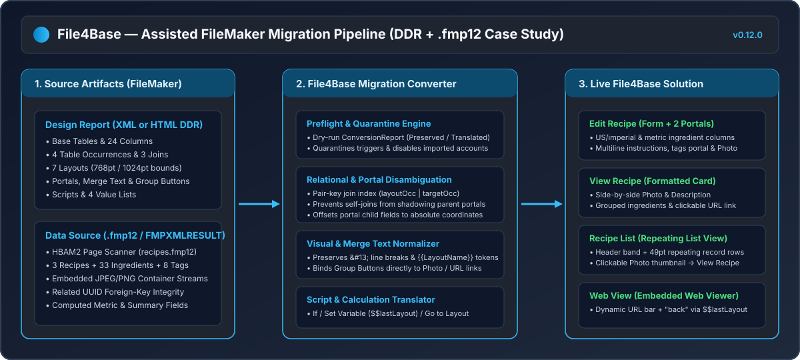
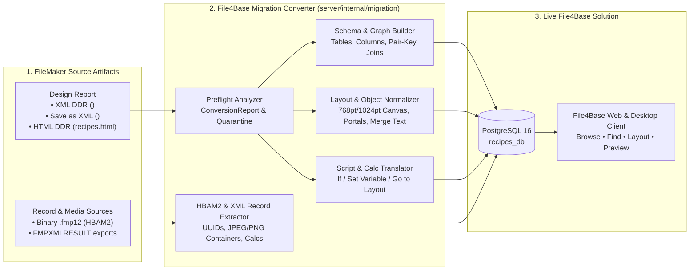
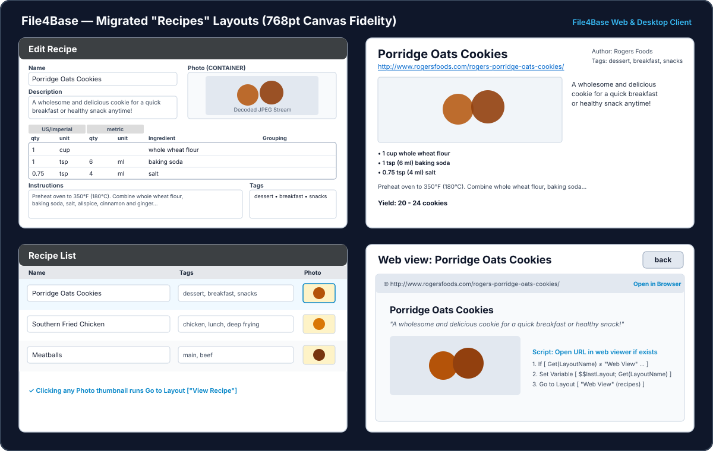
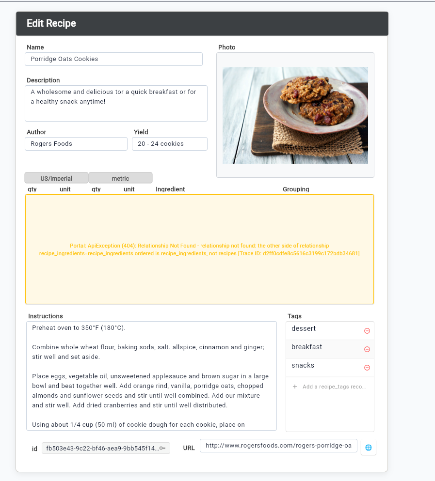
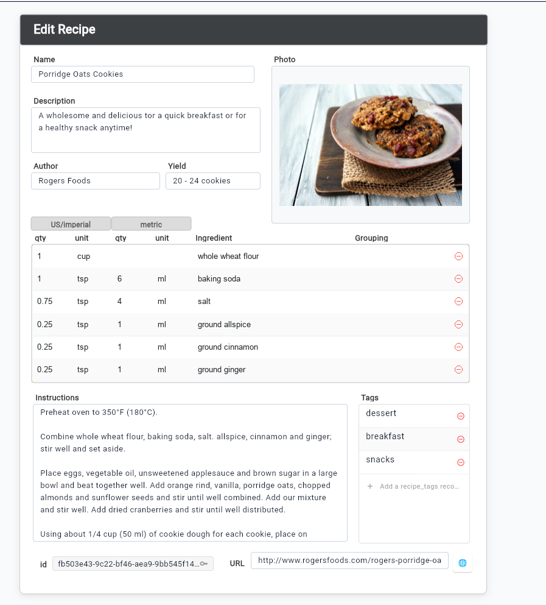

# Migrating from FileMaker to File4Base: Practical Guide & End-to-End Case Study (`Recipes`)

> **Disclaimer:** File4Base is an independent open-source project (`GPL-3.0-only`). Claris, FileMaker, and FileMaker Pro are trademarks of Claris International Inc., referenced here solely to document functional interoperability and migration workflows. The case study in this guide uses the public open-source sample database [`peterhebert/FileMaker-recipe-database`](https://github.com/peterhebert/FileMaker-recipe-database) (`recipes.fmp12` and its HTML Database Design Report `recipes.html`).

---

## 1. Overview & Migration Architecture

File4Base provides an **Assisted FileMaker Migration Engine** (`server/internal/migration`) that converts FileMaker design reports (XML or HTML DDR) and record exports (`FMPXMLRESULT` or binary `.fmp12` containers) into a native, relational PostgreSQL/MariaDB database and interactive JSON layouts rendered by the File4Base Desktop and Web Client.





---

## 2. Supported Source Combinations

| Artifact | Supported Formats | What File4Base Extracts |
|---|---|---|
| **Design Structure (`design_xml`)** | • FileMaker XML DDR (`<FMPReport>`)<br>• FileMaker Save as XML (`<FMPSaveAsXML>`)<br>• FileMaker HTML DDR (`recipes.html` / `Summary.html`) | Base tables, fields (`Text`, `Number`, `Date`, `Timestamp`, `Container`, `Calculation`, `Summary`), Table Occurrences, Relationships (`=`, `≠`, `<`, `≤`, `>`, `≥`), Value Lists, Layouts (parts, fields, portals, merge labels, group buttons, web viewers), Scripts, and Accounts. |
| **Records & Media (`fmp12_base64` / `data_files`)** | • Binary `.fmp12` container (`HBAM2` page scanner)<br>• `FMPXMLRESULT` XML exports per table | Table rows, primary/foreign UUID keys, embedded `JPEG` and `PNG` binary streams for `CONTAINER` columns (encoded as base64 data payloads), and pre-evaluated relational calculation/summary fields. |

---

## 3. Step-by-Step Migration Walkthrough

### Option A: Using the File4Base Desktop or Web Client UI

1. Open **File4Base Web Client** (`http://localhost:8090` or `http://localhost:3000`) or the native Desktop Client.
2. From the top menu bar, select **`File > Import > FileMaker XML / DDR Migration...`** (or select a `.fmp12` / `.html` / `.xml` file in `File > Open Solution...`).
3. In the **FileMaker Migration Assistant**:
   - **Design Document:** Choose your XML DDR, Save-as-XML, or HTML DDR file (e.g., `documentation/recipes_ddr/recipes.html`).
   - **Binary `.fmp12` / Record Exports (Optional):** Attach `recipes.fmp12` (or `FMPXMLRESULT` files) to migrate all records and embedded `CONTAINER` photos in the same operation.
   - **Target Database:** Enter a new database name (e.g., `recipes_db`) and initial owner credentials (`admin` / `Admin1234!`).
4. Click **Run Preflight Check** to inspect the read-only `ConversionReport` (`Preserved`, `Translated`, `Unsupported`, `Rejected`, and `Manual Action Required`).
5. Click **Apply Migration** to create the isolated PostgreSQL database, import all schema objects, layouts, scripts, value lists, and records atomically, and switch directly into the migrated solution.

### Option B: Using the REST API (`curl` / Python)

You can automate the entire migration from the command line or CI pipelines via `POST /api/v1/solutions/migrate/apply`:

```python
import base64, json, urllib.request

BASE = "http://localhost:8080/api/v1"

with open("documentation/recipes_ddr/recipes.html", "r", encoding="utf-8") as f:
    ddr_html = f.read()
with open("recipes.fmp12", "rb") as f:
    fmp_b64 = base64.b64encode(f.read()).decode("ascii")

payload = json.dumps({
    "solution_name": "Recipes",
    "design_xml": ddr_html,
    "fmp12_base64": fmp_b64,
    "target_database": "recipes_db",
    "owner_user": "admin",
    "owner_password": "Admin1234!"
}).encode("utf-8")

req = urllib.request.Request(
    f"{BASE}/solutions/migrate/apply",
    data=payload,
    headers={"Content-Type": "application/json"},
    method="POST",
)
with urllib.request.urlopen(req) as resp:
    result = json.loads(resp.read().decode("utf-8"))
    print("Status:", result["status"], "| Records inserted:", result["records_inserted"])
```

---

## 4. Real-World Case Study: The `Recipes` Database (`recipes.fmp12`)

When migrating [`peterhebert/FileMaker-recipe-database`](https://github.com/peterhebert/FileMaker-recipe-database), File4Base imports the complete multi-table relational application in a single atomic transaction:

| Domain | Migrated Count | Details in `recipes_db` |
|---|---:|---|
| **Base Tables** | `3` | `recipes` (10 columns), `recipe_ingredients` (10 columns), `recipe_tags` (4 columns) — **24 columns total** |
| **Table Occurrences** | `4` | `recipes`, `recipe_ingredients`, `recipe_ingredients ordered`, `recipe_tags` |
| **Relationships** | `3` | `recipe_ingredients = recipes`, `recipe_tags = recipes`, `recipe_ingredients = recipe_ingredients ordered` |
| **Value Lists** | `4` | `ingredient groupings`, `ingredients`, `units imperial`, `units metric` |
| **Layouts** | `7` | `Edit Recipe`, `View Recipe`, `Recipe List`, `Web View`, `ingredients`, `tags`, `unit conversions` |
| **Scripts** | `1` | `Open URL in web viewer if exists` (4 steps) |
| **Records & Photos** | `44` | `3` recipes (*Porridge Oats Cookies*, *Southern Fried Chicken*, *Meatballs*) with embedded JPEG photos, `33` ingredient rows, and `8` tag rows |



---

## 5. Engineering Lessons & Edge Cases Solved During Migration

Real-world FileMaker solutions rely on layout idioms, implicit coordinate systems, and relational conventions that a naive importer will misrender. Below are the six key challenges encountered in `Recipes` and how File4Base solves them automatically:

### 5.1. Self-Join Disambiguation in Portals (`recipe_ingredients`)
- **The FileMaker Pattern:** In `recipes.html`, the `recipe_ingredients` table participates in **two** relationships:
  1. `recipe_ingredients = recipes` (joining a recipe to its ingredients on `id_recipe = id`)
  2. `recipe_ingredients = recipe_ingredients ordered` (a self-join used by FileMaker calculations to order ingredient groupings)
- **The Pitfall:** Indexing relationships by a single occurrence name (`relIDByOccurrence["recipe_ingredients"]`) caused the later self-join `recipe_ingredients = recipe_ingredients ordered` to overwrite the parent-to-child relationship ID. Opening `Edit Recipe` then produced a `404 Relationship Not Found` warning inside the ingredients portal because the other side of the self-join was `recipe_ingredients` instead of `recipes`.
- **The File4Base Solution:**
  - The migration converter (`server/internal/migration/html_ddr.go`) indexes relationships by the **occurrence pair** `layout_occurrence|target_occurrence` (`recipes|recipe_ingredients`), guaranteeing that portals on `Edit Recipe` always bind to `recipe_ingredients = recipes`.
  - On the client (`client/lib/features/data_browser/related_records.dart`), `RelatedContext.resolve` additionally verifies that the starting side of a portal's relationship matches the layout's base table (`fromTable`) and automatically falls back to scanning the relationship graph for a valid join connecting `fromTable` to `occurrence`.

| Before Pair-Key Join Disambiguation (`404 Relationship Not Found`) | After Pair-Key Join Disambiguation (16 Related Ingredient Rows) |
| --- | --- |
|  |  |

### 5.2. Portal Child Coordinates & Duplicate `(0, 0)` Regular Fields
- **The FileMaker Pattern:** In a FileMaker HTML DDR, a layout lists portal child fields twice: once inside the `Portals` section (with relative coordinates inside the portal row) and again inside the `Regular Fields` section (sometimes with `(Top: 0 pt, Left: 0 pt)` or relative row coordinates `Top: 2 pt`).
- **The File4Base Solution:**
  - Portal child fields are offset by their parent portal's origin (`x = portal.Left + child.Left`, `y = portal.Top + child.Top`) so `portal.contains(child)` holds true on the File4Base layout canvas.
  - Any duplicate entry in `Regular Fields` matching a portal child key or having relative row coordinates (`top < 40`) on a portal occurrence is automatically filtered out, eliminating stray overlapping boxes at the top of the layout.

### 5.3. `CONTAINER` Image Extraction & Rendering (`recipes::Photo`)
- **The FileMaker Pattern:** `recipes.fmp12` stores recipe photographs as embedded binary `JPEG` streams inside `HBAM2` container pages, while `recipes.html` declares `recipes::Photo` as a `Container` field on `Edit Recipe` (`326×259 pt`), `View Recipe` (`463×311 pt`), and `Recipe List` (`58×34 pt`).
- **The File4Base Solution:**
  - `server/internal/migration/fmp12_records.go` scans the `.fmp12` container streams, extracts the embedded `JPEG`/`PNG` payloads, and associates each image (as base64) with its recipe record.
  - `DataBrowserWidget` and `ReportView` inspect `col.fieldType == 'CONTAINER'`, decode the base64 image bytes via `Image.memory`, and render interactive image frames in Form view, clickable thumbnails in List view (`Recipe List`), and scaled images in Preview/Report view.

### 5.4. `Group Buttons` Wrapping Fields and Merge Text
- **The FileMaker Pattern:** In FileMaker, turning an existing field (`recipes::Photo` on `Recipe List`) or merge text (`<<recipes::URL>>` on `View Recipe`) into a clickable button creates a **Group Button** at the object's layout coordinates and moves the inner field/merge text to relative coordinates `(0, 0)`.
- **The File4Base Solution:**
  - When a `Group Button` wraps a field (`<b>Type:</b> <li><em>recipes</em>::Photo</li>`), File4Base transfers the button's coordinates and `action` (`Go to Layout ["View Recipe"]`) directly onto the field object instead of covering the photo thumbnail with an opaque button.
  - When a `Group Button` wraps merge text (`<<recipes::URL>>`), File4Base styles the button as a transparent, left-aligned underlined link (`#0066CC`) and suppresses the duplicate `(0, 0)` merge label.

### 5.5. Multiline Merge Blocks (`&#13;`) & `{{LayoutName}}`
- **The FileMaker Pattern:** FileMaker HTML DDRs encode carriage returns inside merge text blocks as `&#13;` (e.g., `<<recipes::ingredients_formatted>>&#13;&#13;<<recipes::Instructions>>&#13;<<recipes::yield calc>>`) and use the `<<LayoutName>>` layout symbol in dark header bars.
- **The File4Base Solution:**
  - `cleanHTMLMergeText` preserves `&#13;` (`\r`) and `¶` as `\n` line breaks while collapsing horizontal HTML whitespace.
  - `resolveLayoutMergeText` resolves `{{LayoutName}}` / `{{layout_name}}` and matches field tokens case-insensitively and across `snake_case` SQL identifiers.

### 5.6. Client-Side Script Execution (`Open URL in web viewer if exists`)
- **The FileMaker Pattern:** Clicking the `{{url}}` link on `View Recipe` or the `🌐` button on `Edit Recipe` runs the script `Open URL in web viewer if exists`:
  ```text
  If [ Get ( LayoutName ) ≠ "Web View" and not IsEmpty ( recipes::URL ) ]
      Set Variable [ $$lastLayout; Value:Get ( LayoutName ) ]
      Go to Layout [ "Web View" (recipes) ]
  End If
  ```
  And clicking the **`back`** button on `Web View` executes `Go to Layout [ $$lastLayout ]`.
- **The File4Base Solution:**
  - `LayoutActionRunner` (`client/lib/features/layout_engine/layout_action_runner.dart`) normalizes both FileMaker Title Case (`Go to Layout`, `Set Variable`, `If`, `End If`) and `snake_case` step names, evaluates compound `and`/`or` expressions with `≠`, `Get ( LayoutName )`, and `IsEmpty(...)`, persists `$$lastLayout` in `globalVariables`, navigates to `Web View`, and returns to the exact originating layout (`Edit Recipe` or `View Recipe`) when **`back`** is clicked.

---

## 6. Post-Migration Verification Checklist

After running a migration into File4Base, verify the following items:

1. **Preflight & Quarantine Review:** Check `manual_action_required` in the migration report for any quarantined script triggers or disabled accounts that need passwords assigned in `File > Manage > Security...`.
2. **Portal Relationships:** Open layouts containing portals (such as `Edit Recipe`) and confirm that each portal loads its related child rows and allows inline editing/creation.
3. **Container Media:** Verify that `CONTAINER` fields render decoded images in Browse (Form and List) and Preview modes.
4. **Navigation Scripts:** Click layout navigation buttons, photo thumbnails, and web viewer buttons to verify `Go to Layout` and `$$lastLayout` state transitions.
